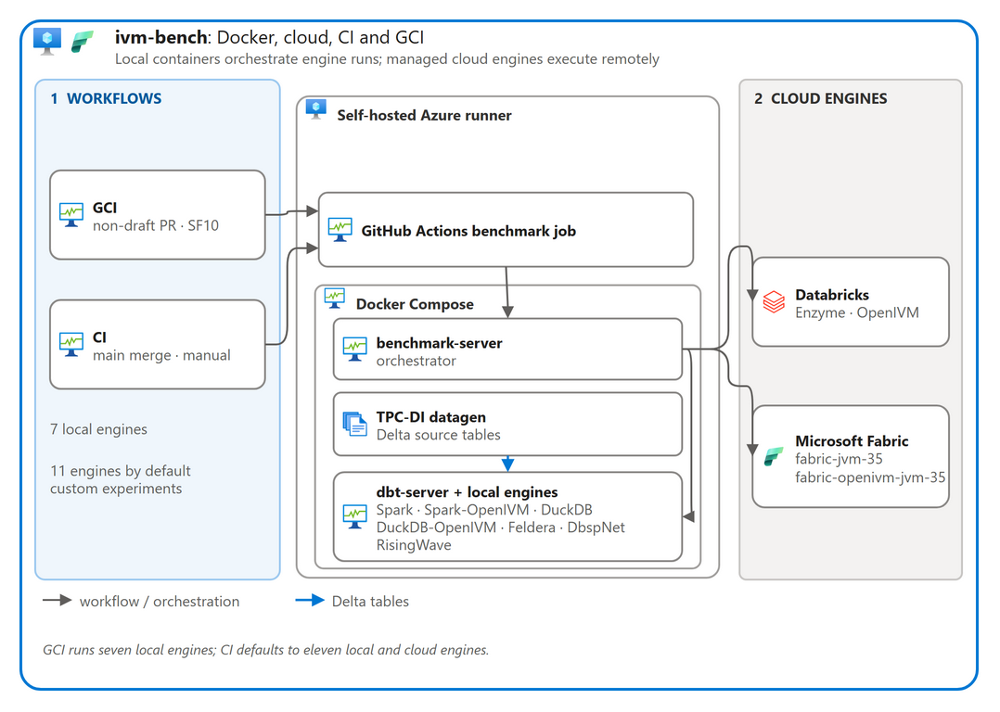

<p align="center">
  
</p>

# dbt - Incremental View Maintenance Benchmark

<p align="center">
Benchmarking engine-specific IVM implementations using a TPC-DI dbt project, <em>without</em> using <a href="https://docs.getdbt.com/docs/build/incremental-models">dbt incremental</a> (because watermark columns are unreliable).
</p>

[dbt Docs](https://docs.getdbt.com/) · [Everything You Need to Know About Incremental View Maintenance](https://materializedview.io/p/everything-to-know-incremental-view-maintenance) · [Short doc on IVM](https://rakirahman.blob.core.windows.net/public/books/INCREMENTAL_VIEW_MAINTENANCE.pdf) · [DBSP Paper](https://bit.ly/dbsp-paper-full) · [OpenIVM Paper](https://bit.ly/openivm-paper)

Benchmarks Incremental View Maintenance capabilities on various Open Source engines with [the TPC-DI-based data model](https://www.tpc.org/tpcdi/) for **educational purposes**.


## Benchmark at a glance

TPC-DI data is generated and converted to Delta Lake, then materialized through
dbt across local Docker engines and managed cloud services.



### Run a smoke benchmark

```bash
export GIT_ROOT=$(git rev-parse --show-toplevel)
export BENCHMARK_EXPERIMENTS_FILE="$GIT_ROOT/src/containers/benchmark-server/experiments/smoke.json"
bash src/.scripts/benchmark.sh
```

See [Quickstart](docs/QUICKSTART.md) for setup and benchmark options.

## Table of Contents

- [Quickstart](docs/QUICKSTART.md)
- [Docker, cloud, CI and GCI](docs/CI_VS_GCI.md)
- [Benchmark workloads](docs/WORKLOADS.md)
- [Engines and compiler benchmark](docs/ENGINES.md)
- [Mount layout](docs/MOUNT_LAYOUT.md)
- [Spark metrics A/B](docs/SPARK_METRICS.md)
- [Results](docs/RESULTS.md)
- [OAT sweeps](docs/OAT_SWEEPS.md)
- [SQL catalog](docs/SQL_CATALOG.md)
- [DBSP.NET engine](docs/DBSPNET.md)
- [Fabric validation](docs/FABRIC_VALIDATION.md)
- [OpenIVM profiling](docs/OPENIVM_PROFILING.md)
- [Benchmark disclaimer](docs/DISCLAIMER.md)
- [Contributing](CONTRIBUTING.md)
