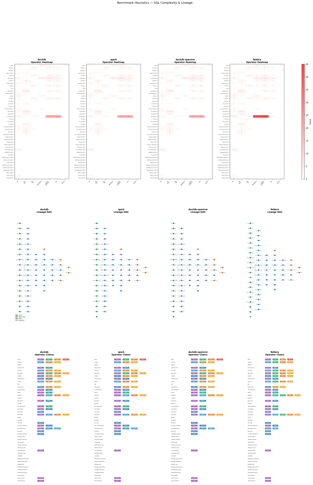

# Benchmark results

[Back to README](../README.md)

---

## Results

### Notes

- The Feldera initial run compiles a Rust Binary for all SQL in a pipeline - [see here](https://github.com/mdrakiburrahman/feldera/blob/dev/mdrrahman/research/.research/demo/docs/00-end-to-end.md#2-sql-submission-to-running-pipeline), which takes a long time for the pipeline start in batch 1
- Since duckdb runs in proc in the `dbt-server`, 2 additional cores are allocated for the server vs. other engines which run dedicated
- Feldera takes ALL queries in the model and compiles it into a single binary that represents a circuit. So when `dbt` runs, it's not query-by-query, but rather the circuit flushes as it proceeds. As a result, all "tables" finish around the same time roughly.
- All results below were generated on an `E32AS_v4` Azure VM. Do **not** commit results from your local machine as the hardware may vary.
- Docker is NOT very good at resource isolation, the screenshots below must be generated with `PARALLEL=0`
- The PNGs below are illustrative snapshots from prior runs. Current OAT runs emit `chart-oat.png` + `chart-per-model.png` into `mount/oat-state/<run_id>/` instead.

### Resource allocation

- The OSS engines run under an Azure VM at `Standard_E32as_v4` (32 cores).
- For closed source engines such as Databricks Enzyme with abstraction layers such as DBU, we use a:

  - [Heuristic UDF](https://github.com/mdrakiburrahman/ivm-bench/issues/22) `SELECT detect_cpu_and_ram()`
  - [VM mapping](https://docs.databricks.com/aws/en/compute/sql-warehouse/warehouse-behavior)

  To land on a `Small` SQL Warehouse resource to ~roughly match our 32 core machine (keeping in mind Databricks runs Drivers/Executors on seperate hosts).

### Query Heuristics

- Databricks Enzyme fails incrementalization for queries it cannot incrementalize with [`REFRESH POLICY INCREMENTAL STRICT`](https://community.databricks.com/t5/technical-blog/from-surprise-full-refreshes-to-predictable-bills-refresh-policy/ba-p/157365). It is possible that the other engines are either:

  1. Superior at incrementalizing a class of queries that Enzyme cannot
  2. Are incorrectly incrementalizing queries and failing silently

  In order to keep all IVM engine benchmarks in relative lockstep, we go ahead and write all queries to have similar IVM semantics with the lowest common denominator.

  In future, as per engine can expose an "incrementalizable dry run" similar to [`EXPLAIN CREATE MATERIALIZED VIEW`](https://docs.databricks.com/aws/en/sql/language-manual/sql-ref-syntax-qry-explain-materialized-view), we can dynamically set the refresh type to `auto` per engine or when an engine complains, make it run `full`. This way,
  engines that **can** incrementalize a query performantly will, and beat the competitor fairly.

### Benchmark Heuristics

### Scale Factor: 3 (100%, 1%, 2%)

### Scale Factor: 25 (100%, 1%, 2%)

### Scale Factor: 100 (100%, 1%, 2%)

