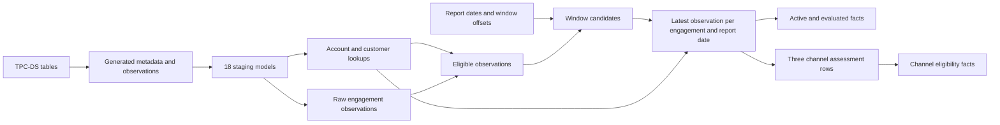

# Extended TPC-DS workload

Extended TPC-DS combines TPC-DS retail data with generated metadata and a
materialized analytical pipeline patterned after Insights. It is an experimental
IVM workload derived from TPC-DS, with its own queries, data profiles and update
streams. Its results are not comparable to officially published TPC-DS results.

The standalone implementation generates 18 extension sources and materializes all
96 translated models in DuckDB. It reports intermediate row counts and checks
temporal cardinality and monthly quantity independently. The mutation planner and
standalone benchmark support insertion, updates, deletes, daily arrivals, repeated
insertions and mixed DML. The OAT harness now dispatches this workload to DuckDB
and DuckDB-OpenIVM. The standalone DuckDB runner measures full recomputation;
OpenIVM correctness failures remain visible and fail the OAT experiment.
The [recorded SF 0.01 validation](../src/workloads/extended-tpcds/validation/sf001.json)
contains source statistics and all 96 intermediate/output counts for each profile.

## Run the standalone workload

Use Python 3.10 or newer and the pinned DuckDB package:

```bash
python3 -m venv /tmp/extended-tpcds-env
/tmp/extended-tpcds-env/bin/pip install -r src/workloads/extended-tpcds/requirements.txt
```

First generate an ordinary TPC-DS database. For example, using that environment's
Python interpreter, create `base.duckdb` with DuckDB's TPC-DS extension:

```python
import duckdb

with duckdb.connect("base.duckdb") as connection:
    connection.execute("INSTALL tpcds")
    connection.execute("LOAD tpcds")
    connection.execute("CALL dsdgen(sf=0.01)")
```

Extension installation requires network access. An existing database with the
seven required TPC-DS tables can also be used: the three sales tables, `customer`,
`item`, `date_dim` and `time_dim`. Record its actual generator and scale explicitly;
omitted provenance fields are reported as unknown, rather than inferred from size.

```bash
/tmp/extended-tpcds-env/bin/python src/workloads/extended-tpcds/generate.py \
  --input-db base.duckdb --output-db extended.duckdb \
  --profile jcc_stress --seed 17 --report-date 2002-12-31 \
  --base-scale-factor 0.01 --base-generator 'DuckDB tpcds extension 1.2.1'
/tmp/extended-tpcds-env/bin/python src/workloads/extended-tpcds/pipeline.py \
  --database extended.duckdb --all-models
```

The output path must be new. Preparation attaches the input read-only and stores
normalized purchases, counted quarantine rows, extension tables and configuration
in the new database. A sibling `.generation.json` records assignments, input row
counts/checksums, achieved statistics and calibration scope. Model execution writes
a sibling `.all.pipeline.json` with per-model row counts, build durations and
validation results. Row-count scans run outside the recorded build durations;
these local durations are diagnostic, not a controlled engine comparison.

Omit `--all-models` to run the dependency closure of the 28-day historical channel
eligibility fact and monthly quantity fact. Add `--cohort hot` or `--cohort cold`
for paired bindings. The binding filters `int_target_engagements` and its consumers;
monthly purchase quantity remains an all-purchases control. Each run replaces
materialized model tables, so save artifacts for each binding and run sequentially
on a given database. The pipeline uses the report date frozen in `xt_run`.

The tests require no downloads and exercise small TPC-DS-shaped inputs:

```bash
/tmp/extended-tpcds-env/bin/python -m unittest discover \
  -s src/workloads/extended-tpcds -p 'test_*.py' -v
```

## Mutation modes and batch replay

Generate an immutable plan once and replay it for each engine and query binding.
Planning reads the generated database without modifying it. Initial loading and
each batch use typed Parquet row images, checksums and a JSON manifest. The source
pool is prepared outside measured model execution. The report date stays fixed
in every mode, including days mode.

| Mode | Changes after initial construction |
| --- | --- |
| `insertion` | A seeded selection of event-feed payloads receives fresh physical IDs; selection varies per batch |
| `updates` | Existing rows change quantity, assessment, parent state, capacity, channel status or offer attributes |
| `deletes` | Existing event rows and current metadata rows are removed, exercising retraction and fallback joins |
| `days` | Previously withheld event rows arrive one calendar day per batch, preserving their original IDs and timestamps |
| `repeated_insertions` | The same selected payloads are inserted each round with new physical IDs; business keys and timestamps repeat |
| `mixed` | Disjoint updates and deletes affect existing rows, followed by inserts |

Construct a three-batch mixed-DML run and check all 96 models after each batch:

```bash
/tmp/extended-tpcds-env/bin/python src/workloads/extended-tpcds/mutations.py \
  --database extended.duckdb --output-dir /tmp/xt-mixed-plan \
  --mode mixed --batches 3 --initial-pct 100 \
  --insert-pct 1 --update-pct 1 --delete-pct 1
/tmp/extended-tpcds-env/bin/python src/workloads/extended-tpcds/benchmark.py \
  --manifest /tmp/xt-mixed-plan/manifest.json --output-dir /tmp/xt-mixed-run
```

Both output directories must be new. `--batches` includes initial construction and
can exceed three. For daily arrivals, use `--mode days --days 7`: the initial state
contains event rows before the seven-day interval ending on the fixed report
date, and the next seven batches release that interval one day at a time. Empty
arrival days are retained as batches. Metadata, registry, catalog and calendar
inputs are loaded upfront. Future event rows beyond the report date are excluded
from the daily scenario. Optional update/delete percentages can accompany days;
an insert percentage cannot override the event-date partition.

For repeated insertions, use `--mode repeated_insertions --batches 10 --insert-pct 1`.
Ordinary and repeated insertions are declared synthetic copies of generated feed
rows, rather than newly generated TPC-DS sales or new customers/items. They retain
the extension entity budget and test multiplicity and deduplication. Original
TPC-DS remains unchanged. Repeated source-image delivery with the same physical
IDs is a retry scenario and is rejected, rather than counted as another insertion.

The five independently arriving feeds are purchase usage, engagement status,
customer status, receipts and secondary observations. Insert percentage is a
deterministic hash-bucket fraction of each frozen feed pool, not of its growing
current table. Initial percentage samples those feeds; static metadata is loaded
in full. Update/delete percentages sample existing rows in nine mutable sources,
using only current rows for metadata histories. Actual affected row counts are
recorded per source and operation. The two mutation buckets are disjoint and their
percentages must sum to at most 100. Fractional percentages are supported.

Updates preserve physical IDs and business identities. Purchase/secondary/receipt
quantities increase by one; engagement assessment keys change; parent state,
store eligibility and account offer toggle; engagement capacity increases by one;
parent capacity/limit increase by one/two. Feeds change independently, modeling
asynchronous observations rather than a coordinated update to an original sale.
Deletes can leave missing current metadata and trigger existing fallback paths.

`--experiment experiment.json` accepts one existing ivm-bench experiment object
or a file containing one `experiments` entry. It honors `batch_1_pct`, `batch_N_pct`
(and `batch_N_insert_pct`), `batch_N_update_pct` and `batch_N_delete_pct`. Generate
the base database at the desired `scale_factor` first; a known mismatch between
that input and the experiment is rejected. Use `mixed` for a mixed-DML experiment.
This imports batch settings for standalone replay. The OAT integration below
uses the same settings and row-image contract directly.

Mutation binding (`mutations.py --mutation-cohort hot|cold`) and query binding
(`benchmark.py --cohort hot|cold`) are independent. A plan records its profile,
source configuration, schedule, seed and mutation binding. Updates carry
before/after images, deletions carry before images, and insertions carry after
images. Adapters must honor batch ordering and update/delete-before-insert order;
DuckDB uses actual SQL `UPDATE`, `DELETE` and `INSERT`. Integrity failures roll back
the batch. Replaying a committed batch or using another plan is rejected.

The standalone benchmark defaults to all 96 models; `--pilot` limits execution to
the two pilot facts and their ancestry. Validation compares every selected model
against a fresh source replay and full recomputation using `EXCEPT ALL`, preserving
duplicates, nulls and surrogate keys. The reference reverses physical input order
to detect ambiguous winner selection. Independent temporal/quantity checks run
too. Validation is enabled by default; `--no-validate` disables it explicitly.
`results.json` and `work.duckdb` retain each run's evidence and final state.
Source-replay wall time includes integrity guards and is labeled as such; model
SQL durations exclude source replay and reference validation. These are diagnostic
full-recomputation runs, rather than incremental-engine timings.

The [recorded mode validation](../src/workloads/extended-tpcds/validation/modes-sf001.json)
covers eight real SF 0.01 scenarios and 17 snapshots: mixed DML checks all 96 models
on each profile, and the other five modes check the 50-model pilot closure on the
stress profile. All 1,126 model comparisons matched. Small-input tests cover all
96 models for every mode after every batch, plus atomicity and cohort isolation.

## OAT integration and current engine results

Use the checked-in [mixed-DML smoke experiment](../src/containers/benchmark-server/experiments/extended-tpcds-smoke.json)
through the existing entry point:

```bash
export BENCHMARK_EXPERIMENTS_FILE="$PWD/src/containers/benchmark-server/experiments/extended-tpcds-smoke.json"
bash src/.scripts/benchmark.sh
```

For execution on a laptop, use `HOST_CORES=4 HOST_MEMORY=5 bash src/.scripts/benchmark.sh`.
The serial engine containers then receive four CPUs and 5 GiB each, with a 4 GB
DuckDB query budget during execution; OpenIVM validation uses the harness's
existing smaller allocation. Preparation independently defaults to four CPUs,
a 5 GiB container, a 4 GB DuckDB query budget and 4 GB of spill files. Larger
preparation budgets can be set with `EXTENDED_TPCDS_CPUS`, `EXTENDED_TPCDS_MEM`,
`EXTENDED_TPCDS_MEM_LIMIT` and `EXTENDED_TPCDS_MAX_TEMP_DIRECTORY_SIZE`. The last
setting also bounds spill files in the CLI engines and their reference checks.
Image compilation uses the Docker builder's separate resource allocation.
The acceptance smoke requires materialized views (`fallback_policy: "strict"`).
The [mode/profile experiment file](../src/containers/benchmark-server/experiments/extended-tpcds-modes.json)
provides all six modes on the native profile and mixed DML on the calibrated and
stress profiles, using the same OAT entry point. Days and repeated insertions
include a fourth snapshot. Both query and mutation cohorts are `all` in these
acceptance scenarios.

The new `workload: "extended-tpcds"` selector keeps TPC-DI as the default. The
`extended_tpcds` object controls profile, mode, seed, report date, history length,
batches/days, independent query/mutation cohorts, statement timeout and fallback
policy. The default timeout is 300 seconds per SQL statement, including reference
validation. Fractional positive scale factors are accepted for Extended TPC-DS; TPC-DI
continues to require integer scales. Batch percentages retain the existing names.
For more than three batches, batch-three percentages repeat; days mode uses zero
insert percentages and releases rows by event day instead. Unsupported engines
are rejected before preparation; Spark and Feldera integration remains open.

A pinned DuckDB 1.2.1 preparation container generates TPC-DS at the requested scale,
the metadata extension and one immutable mutation plan. Cache identities include
workload, scale, profile, mode, seed, schedule and bindings. Both engine services
mount that plan read-only, and use the same DuckDB CLI build with native table
storage. This storage choice is recorded explicitly; per-relation storage
accounting for this workload is not integrated, and the smoke experiment disables
storage metrics. Existing TPC-DI DuckLake paths retain their original dispatcher.
Revision-matched JSON and ICU extensions are exported with the OpenIVM binary so
engine execution can run offline.

DuckDB recomputes every materialized model in dependency order. OpenIVM creates
materialized views on initial construction and calls its refresh API in the same
order after each mutation batch. Classification uses the public `refresh_status`
API, including actual strategy names such as `window_partition` and
`group_recompute`: an incremental classification can therefore include affected
partition/group recomputation. Unknown strategies remain unknown. A rejected
`CREATE MATERIALIZED VIEW` can become an explicitly labeled table fallback under
`fallback_policy: "table"`; `strict` rejects it. Refresh errors and output
mismatches always fail rather than being converted into fallback passes.

Source replay includes integrity guards. Model wall time includes CLI round trips,
catalog probes and row counts; each model also records its CLI SQL timer separately.
Validation uses a fresh replay and a full recomputed DAG in another catalog,
compares all 96 models with `EXCEPT ALL`, retains keys/nulls/duplicate multiplicity,
and rounds FLOAT/DOUBLE to ten decimal places using the existing engine verifier.
HTTP validation is a separate post-timer request, outside controlled CPU sampling.
Result JSON and CSV include the workload, plan ID, profile/mode/bindings and model
classification counts. Variable batch counts are preserved in the result model,
SQLite batch records and CSV. Source/model definitions and query binding are frozen
for the run; changing them requires new engine state.

The pinned OpenIVM revision `91ae4040438cb1b0cf11c04b9f68a20cfadf9c48`
passes native-profile SF 0.03 initial construction and two mixed-DML batches.
All 96 models match a fresh full-DAG recomputation after every snapshot: 288
comparisons, with all models classified incremental and no table fallbacks.
The [native CLI evidence](../src/workloads/extended-tpcds/validation/engines-native-sf003.json)
records the engine/generator revisions, plan identity, SQL identity, intermediate
counts, timings and validation results. This run used four threads, 4 GB of query
memory, a 300-second statement timeout and a 4 GB spill limit. An external laptop
watchdog limited combined RSS to 5 GiB and swap growth to 512 MiB.

Historical household joins use `IS NOT DISTINCT FROM` instead of an equivalent
equality/null OR expression. The latter chose a blockwise nested-loop join and
exceeded 300 seconds during SF 0.03 initial construction. The new form enables a
hash join; the complete checked run took about 254 seconds. A regression compares
all nine affected model bags against the original predicate with null and zero
identifiers and duplicate inputs.

The [SF 0.01 native CLI mode/profile matrix](../src/workloads/extended-tpcds/validation/engines-native-sf001-modes.json)
passes 2,784 model comparisons across 29 snapshots: all six modes on native data,
mixed DML on calibrated and stress data, and a paired DuckDB baseline for native
mixed DML. Days and repeated insertions each cover four snapshots. Every OpenIVM
snapshot classifies all 96 models as incremental. These checks use the actual
Flask batch/validation endpoints with local path injection. Peak combined RSS
was about 2.24 GiB, and system swap usage did not grow. The timings are diagnostic
correctness-run artifacts, rather than controlled performance comparisons.
The [preparation check](../src/workloads/extended-tpcds/validation/preparation-sf001.json)
also exercises the actual preparation function, with the official cached TPC-DS
extension, and verifies the query/thread/spill limits in all three connections.

Docker lifecycle and controlled CPU sampling have not been exercised on the
development laptop, where Docker is unavailable. The PR's GCI selector runs the
paired Docker/OAT smoke; its result must be checked independently of native CLI
validation. The [earlier local engine evidence](../src/workloads/extended-tpcds/validation/engines-local.json)
retains historical failures from older builds, before the required OpenIVM fixes.

CI installs the test dependencies and runs all three test directories. To run the
same tests locally, install `src/workloads/extended-tpcds/requirements-test.txt`,
then use `python -m unittest discover -s DIRECTORY -v` for
`src/containers/benchmark-server/tests`, `src/containers/dbt-server/tests`, and
`src/workloads/extended-tpcds`. The tests include actual PNG exports for one- and
five-snapshot reports; OAT timing tables and per-model plots retain later batches
and compare DuckDB-OpenIVM with the DuckDB baseline.

## Workload structure

Retain the 96 materialized model roles: 18 staging models, 43 intermediates,
11 dimensions, 23 facts and one metadata model. Preserve the dependency graph,
shared intermediates and roughly ten model levels, counting staging as level one.
The checked-in SQL dependency graph matches the model mapping; the metadata
model retains its four logical ordering dependencies even though its SQL is constant.

The 23 facts comprise three measures (active, evaluated and channel eligibility)
at three window widths (1, 7 and 28 days), both at one report date and over a
12-month history; four monthly snapshots; and a wide summary of the three
windows. Shared results remain materialized rather than being expanded into
independent queries. The ingestion metadata model follows the four monthly
facts, matching the original dependencies.

The complete [model mapping](../src/workloads/extended-tpcds/model-mapping.csv)
records each original role, retail model name, dependencies, grain, cardinality
rule and committed seed row count. Seed counts describe the original small run
only; they are not scaled production predictions. `int_engagement_channel_assessment`
is retained as a standalone output even though no original model consumes it.



## Retail entities and ownership

Use a customer-item engagement as the repeatedly observed entity. Multiple
orders for the same engagement provide observations over time. This makes the
ranking operations substantive; ranking by a unique sales line would not.

Keep business engagement IDs distinct from registry keys. A registry key identifies
a registration incarnation; several registry keys may refer to the same business
engagement. Historical snapshot ranking partitions by registry key, while monthly
status ranking partitions by business engagement ID. Physical registry history
rows have their own unique row IDs and may repeat a registry key before staging
deduplication. The cardinality utility takes registry keys as its entity identity.
The current generator creates one registration incarnation per engagement, with
two physical registry versions by default. Multiple incarnations remain a future
scenario; the separate identity columns retain that distinction in the queries.

| Insights role | Retail interpretation | Origin and identity |
| --- | --- | --- |
| Instance | Customer-item engagement | Extension key `(account_id, i_item_id)` |
| Machine | Customer profile | TPC-DS `c_customer_id` |
| Subscription | Purchasing or loyalty account | Generated account, owning one customer |
| Tenant | Loyalty household | Generated household with several accounts |
| Customer reporting identity | Household reporting identity | Generated household identifier |
| Meter | Product price catalog entry | TPC-DS item business ID and generated price metadata |
| Databases attached to instance | Order lines attached to engagement | Registry children derived from sales line identities |
| Three migration targets | Store, catalog and web eligibility | Generated, nullable channel assessments |

Households are explicit extension records. TPC-DS `household_demographics`
describes demographic categories, not individual households, and must not be
used as a household identity. Accounts and households also prevent the ownership
fallback queries from collapsing into repeated joins on the same customer key.

Normalize `store_sales`, `catalog_sales` and `web_sales` to a common purchase
event schema. Use the purchasing customer (`ss_customer_sk`, `cs_bill_customer_sk`,
`ws_bill_customer_sk`) and resolve item surrogate keys to `i_item_id`. Preserve
the original channel, order identifier and item surrogate key as the stable
source-line identity. Resolve customer IDs through `customer`; do not substitute
recipient customers in the catalog and web channels.

Preserve sales with nullable customer or date references through explicit unknown
members or a counted quarantine contract. Never silently discard them during
normalization. Preserve original decimal prices; generated capacity and demand
measures have separate columns and documented units.
When a purchase time lookup is missing, use midnight on its known sale date.
This declared timestamp assumption differs from missing-date quarantine; the
current statistics do not separately count missing time references.

Raw TPC-DS remains reproducible and separately addressable. Native and calibrated
working datasets live in different namespaces and have different cache identities.
TPC-DS inventory can be used in later scenarios, but its weekly observations and
small warehouse dimension do not drive this engagement pipeline.

## Metadata extension sources

The 18 staging roles read these source relations. Source preparation, including
the TPC-DS projections, is outside the 96-model analytical DAG. The benchmark must
report preparation separately from initial pipeline construction and maintenance.

| Extension source | Purpose |
| --- | --- |
| `ext_entity_registry` | Versioned customer, engagement and order-line identities; parsed parent-child paths |
| `ext_price_catalog` | Product price and classification metadata, including deliberately missing catalog entries in configured scenarios |
| `ext_purchase_usage_events` | Normalized sale quantities and timestamps |
| `ext_account_profile` | Account ownership, household reporting identity, offer and usage attributes |
| `ext_calendar` | Projection of non-null TPC-DS dates; missing purchase dates are quarantined |
| `ext_customer_policy_history` | Nullable policy attributes with timestamps and multiple versions |
| `ext_engagement_service_history` | Engagement service role and effectivity |
| `ext_engagement_activity_history` | Observed, reported and unknown activity modes |
| `ext_engagement_capacity_history` | Relationship type, parent customer and reported/allocated units |
| `ext_engagement_channel_history` | Store/catalog/web eligibility, assessment key and observation timestamps |
| `ext_engagement_status_events` | Repeated observations of engagement state |
| `ext_engagement_product_history` | Product tier/version attributes for engagement lookups |
| `ext_customer_profile_history` | Parent capacity/limit measures, platform and channel flags |
| `ext_customer_preference_history` | Preference type and SKU-like category with normalization cases |
| `ext_customer_status_events` | Repeated parent state, including inactive states |
| `ext_purchase_receipt_events` | Timestamped JSON observations for parsed fallback data |
| `ext_engagement_observation_events` | Secondary observations, including string-encoded unit measures |
| `ext_account_household` | Account-household relationships for ownership matching |

All extension identities and payloads are generated from TPC-DS keys and a fixed
seed. Production rows and original seed CSVs are not inputs to the extension.

## Data profiles and join crossing correlations

[profiles.json](../src/workloads/extended-tpcds/profiles.json) separates measured
reference statistics from generation settings and future experiment requirements. No production intermediate
count is treated as known. The three profiles serve different experiments:

| Profile | TPC-DS working data | Metadata and purpose |
| --- | --- | --- |
| `native` | Unmodified generated rows | Necessary extension metadata, without injected skew; control workload |
| `calibrated` | Unmodified generated rows | Synthetic status density and three metadata probability targets |
| `jcc_stress` | Unmodified generated rows | Status observations reassigned to hot engagements; a chosen correlation stress scenario |

The implemented calibration targets are status events per registry key, purchase
relationship frequency in current capacity metadata, and store/catalog/web
assessment non-null probabilities. Calibrated status dates are seeded uniformly
over the 365 days ending on the report date, at 14:00. Each engagement receives
three or four observations to match the reference mean. This is an assumed
temporal distribution; it does not reconstruct production history. Metadata
probabilities are sampled independently of event eligibility and therefore do not
establish event-level production selectivity. Finite-population deviations are
reported, including separate store and catalog achieved fractions.

The remaining nine reference metrics, including volume ratios, fanout tails and
numeric correlations, are unimplemented targets. Generation artifacts mark these
as unimplemented and leave their observed calibration values null. Generated
numeric formulas currently create their own correlations, which must not be
presented as calibrated to the reference correlations.

Current chosen defaults are two accounts per customer, up to two known customers per household,
two metadata versions, and omission of primary capacity metadata for every tenth
engagement to exercise the observation/receipt fallback joins. Unknown customers
belong to an explicit unknown household outside hot/cold cohorts. Household
cohorts follow a seeded customer ordering; ties in cohort size depend on the number
of households. In native and stress profiles, channel assessment non-null
probability is 0.75 and every engagement has a purchase relationship. These are
chosen scenario settings, not measurements from the production seed.

JCC-H correlates hot foreign keys with predicates across joins and provides normal
and skewed bindings for the same query templates. Adopt that experimental pattern,
without claiming that the resulting workload reproduces production. For example:

1. Assign equally sized hot and cold household cohorts using a seeded permutation.
2. In the stress profile, assign 25% of engagement observations to five hot
   engagements owned by households in the hot cohort. Select hot engagements with
   primary capacity metadata and active parents so the injected fanout survives
   eligibility filtering. This is a chosen stress
   setting, not a statistic inferred from Insights.
3. Give the cohorts comparable household-row frequencies and report both
   household selectivity and observation selectivity. The same household predicate
   can then select very different amounts of downstream work.
4. Run the same templates with hot and cold cohort bindings, and record the
   resulting per-key candidate and aggregation distributions. A 25% input hot-key
   share alone is not sufficient evidence of join-crossing effects.

Metadata-only correlation is one valid scenario. Reassigning sales customers or
items is another, and must be declared as a working-data transformation. Reassign
customers per complete order, consistently across its lines and linked returns;
reassign items consistently with sales/returns keys and item effectivity dates.
Keep the lineage from each transformed row to its original source line. Changes
to row counts, dates, quantities or replication each need their own setting.

Construct hot-key ownership first, then assign events and metadata conditionally.
Drawing every field independently loses the correlations being tested. Preserve
unique physical primary keys and known functional dependencies; distinguish
multiple history versions from duplicate current rows. A tail maximum such as
94 does not specify how often that tail should occur.

Before timing a dataset, emit an achieved-statistics report: physical and business
key counts, rows per entity, full/staging row counts, predicate selectivity, missing
references, raw and post-deduplication fanout, versions per key, candidate expansion,
group counts and hot-key shares. Record the generator version, TPC-DS version,
base scale factor, extension seed, profile, bindings and every transformation.
Failed calibration must be visible, not reported as successful fidelity.

## Cardinality contracts

Separate exact counts on a generated dataset, structural bounds and estimates of
production behavior. Source profiles distinguish the full raw table, the staging
predicate slice and the sample population. Use the staging slice to calibrate
the analytical input and the full table only when modeling scans and pruning.

For eligible events at effective date `d`, let `m_W(d)` be the number of report
dates whose width-`W` window includes `d`. Then candidate rows are exactly
`sum_d N_eligible(d) * m_W(d)`, including duplicate event rows. For consecutive
report dates `m_W(d) <= W`, so candidate rows are at most `W * N_eligible`.

The SF 0.01 stress run demonstrates why a single scale multiplier is insufficient.
The same templates and metadata include 250 hot and 251 cold households, with
these measured counts at seed 17 and report date 2002-12-31:

| Historical 28-day stage | Hot binding | Cold binding |
| --- | ---: | ---: |
| Eligible observations | 3,684 | 2,090 |
| Window candidates | 93,978 | 54,910 |
| Selected engagement/report-date rows | 53,106 | 54,756 |
| Three-channel unpivot rows | 159,318 | 164,268 |
| Channel eligibility fact rows | 85,866 | 85,305 |

More hot observations expand the candidate relation, but ranking collapses their
concentrated repetitions. Selected rows can therefore be fewer even when candidate
rows are greater. The monthly quantity control has 6,595 rows under both bindings.
These are exact counts for this generated scenario, not production predictions.

Ranking reduces candidates to one row per `(report_date, engagement_registry_key)`.
Count the union of covered report dates per engagement rather than multiplying
an event count by a seed-derived reduction ratio. Left enrichment preserves this
count only when every lookup is unique on its actual join expression; measure
the enriched count separately. Unpivot produces exactly three rows per enriched
engagement snapshot. Final fact counts require distinct joint grouping tuples.

The [cardinality utility](../src/workloads/extended-tpcds/cardinality.py) calculates
candidate and selected counts from eligible event dates without materializing
every candidate. Its three-way unpivot count is the structural expectation before
any enrichment fanout. It also reports the report-date map size and amplification.
These are output relation counts, not physical bytes or engine auxiliary state.

For example, run the provided fixture:

```bash
python3 src/workloads/extended-tpcds/cardinality.py \
  --events src/workloads/extended-tpcds/fixtures/eligible-events.csv \
  --report-start 2002-01-02 --report-end 2002-01-04 --windows 1 2 3
```

Production-reference statistics do not identify all joint distributions. In
particular, eligibility among events is not the fraction of eligible dimension
rows, and the fraction of inactive historical parent events is not the fraction
of parents whose latest state is inactive. Unknown conditional distributions
remain explicit assumptions and are varied independently.

## SQL translation and maintenance semantics

Translate the shared macro families once and instantiate their window variants.
Keep inner, left, full and anti joins; union distinct versus union all; nullable
join normalization; entity-level deduplication; parent-level distinct sums; and
the original materialization boundaries. Column renaming alone is insufficient.

The monthly quantity fact groups by engagement and catalog entry even where those
identifiers are omitted from the final projection. Preserve that hidden grain and
bag semantics. Do not merge apparently identical output rows. Global row-number
surrogate keys are retained initially because a new ordered member can renumber
existing outputs. A stable-key variant is a separate experiment.

Use a fixed report date during DML experiments. Advancing time is a separate
scenario with an explicit clock relation or declared rebuild behavior; changing
a compiled date literal must not masquerade as ordinary IVM maintenance. Define
inclusive day boundaries explicitly, including events on the report date with
non-midnight timestamps. Test the original point-in-time and historical branches
for differences before selecting their translated semantics.

Specify full tie-breaking orders for latest rows and explicit frames for
`FIRST_VALUE` with ignored nulls. A latest-non-null intent is not automatically
equivalent to an ordered window's default frame followed by `SELECT DISTINCT`.
Exercise leading nulls, equal timestamps and different channel status histories.
Any intentional correction to the original behavior is documented in the mapping.

The DuckDB translation uses an explicit full-partition frame for latest-non-null
channel values, date-inclusive point-in-time windows and hidden business IDs as
monthly quantity surrogate-key tie breakers. Equal-time fallback observations
choose the greatest non-null reported units; channel/assessment lookups use
explicit payload tie breakers. Preference normalization uses a
retail-oriented regex, and offer buckets use retail categories. Casts translated
from Spark use DuckDB `TRY_CAST` where the source's permissive cast returns null.
See [translation provenance](../src/workloads/extended-tpcds/translation.json).
Other original latest-row orderings remain intact: conflicting payloads with equal
ordering timestamps in additional metadata-arrival scenarios need an explicit tie
policy. Equal-time parent states use status descending, so inactive wins active
ties. Equal-valued effective-unit candidates prefer parent capacity, then engagement
units, then receipt units. This affects capacity division when tied source values
would otherwise select different fallback branches. These intentional choices
make the supported mutation schedules deterministic under changed input order.

Generate an initial state and deterministic changes: new purchase/activity events,
late observations, metadata updates, parent activation changes, missing dimensions
arriving later and deletion of a winning latest row. Hot and cold update cohorts
must be reported separately from hot and cold query bindings. Each engine receives
the same ordered mutations and snapshot boundaries.

## Implementation milestones and acceptance

Milestones 1–3 have a standalone DuckDB implementation. Full runs over real
TPC-DS SF 0.01 succeeded for native, calibrated and stress profiles: all 96 model
tables materialized and all ten independent count/quantity checks passed. The
small-input suite also checks leading nulls, report-day observations, winner
deletion, stable generation and hidden monthly grain. The mode tests compare all
96 models after every batch, including empty initial state, complete deletion and
repeated insertions. These checks establish a recomputation baseline. Incremental
engine acceptance in milestone 4 remains failing for the tested OpenIVM builds.
Milestone 5 has DuckDB-family OAT wiring; successful Docker acceptance, other
engines and controlled performance/storage sweeps in milestone 6 remain open.

1. Implement TPC-DS normalization and the extension sources, with immutable raw
   data, stable lineage and achieved-statistics output. Resolve unsupported or
   missing source references without silent row loss.
2. Translate the full ancestry of the 28-day historical channel-eligibility branch
   and the monthly quantity fact. Compare measured candidate and selected counts
   with the cardinality utility and verify the true aggregation grain.
3. Expand the shared templates to all 96 roles and compare the compiled dependency
   graph and materializations with the model mapping. Produce full-refresh output
   baselines for the new retail data, rather than reusing original seed digests.
4. Validate every observable model after each mutation against full recomputation,
   including multiplicity, nulls and numeric tolerances. Count/profile validation
   runs outside timed maintenance windows.
5. Add a workload selector to ivm-bench at the experiment, source-loader and dbt
   project boundaries. Compiler locks/caches, source caches, output paths and
   metrics identities include workload, profile and bindings. Translation reuses
   existing dialect tooling where semantics can be preserved; unsupported SQL and
   full-refresh fallbacks remain visible.
6. Run native, calibrated and hot/cold stress cases on the same engines and report
   initial construction, maintenance time, source preparation and durable/auxiliary
   storage separately. Describe native TPC-DS scale and added extension rows/bytes
   separately, so the combined dataset size is unambiguous.

## References

- [TPC-DS specification](https://www.tpc.org/TPC_Documents_Current_Versions/pdf/TPC-DS_v4.0.0.pdf),
  especially sales identities, inventory frequency and table scaling.
- [JCC-H paper](https://ir.cwi.nl/pub/27429/27429.pdf) and
  [generator](https://github.com/ldbc/dbgen.JCC-H). JCC-H motivates the paired
  bindings and cross-table correlations; it does not establish a production data model.
- [Insights source profile](https://github.com/mdrakiburrahman/dbt-insights/blob/54711257f95d561e00305be33272daba87988da1/docs/PROFILE.md),
  [methodology](https://github.com/mdrakiburrahman/dbt-insights/blob/54711257f95d561e00305be33272daba87988da1/docs/PROFILE-METHODOLOGY.md)
  and [seed output baseline](https://github.com/mdrakiburrahman/dbt-insights/blob/54711257f95d561e00305be33272daba87988da1/scripts/expected-output.json).
  The production profile was collected in August 2026; the reproducible seed
  project uses a frozen report date of 2025-11-03.
