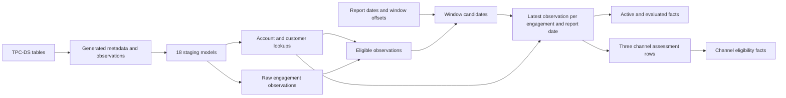

# Extended TPC-DS workload

Extended TPC-DS combines TPC-DS retail data with generated metadata and a
materialized analytical pipeline patterned after Insights. It is an experimental
IVM workload derived from TPC-DS, with its own queries, data profiles and update
streams. Its results are not comparable to officially published TPC-DS results.

### Isolated DBSP.NET spill trial (2026-11-11)

Branch `bench/tpcds-sf25-dbspnet-spill-20261111` is stacked on `a77210b` for a
DBSP.NET-only SF25 rerun with the same 25 GB source target, calibrated profile,
100/1/0.01 insertions and full validation. It pins official upstream main
`b580b7f99b4df5cef3630e3f989c1d5f0fc9b15f`, which includes the memory work
referenced in [issue #2](https://github.com/clast-project/dbsp-net/issues/2#issuecomment-6786398252)
and the merged SQL compatibility PR. No upstream engine code is modified.

This test branch explicitly enables the maintainer's spilling settings: 12
workers, spill on, 262,144-row step chunks, 1,024 MiB block cache, 49,152 MiB
pressure limit, 48 GiB GC heap, server GC on and concurrent GC off. `/spill` is
backed by `mount/spill/<sf>/dbspnet`, outside uploaded artifacts; the regular
workflow mount cleanup removes it before the next run. Checkpoints remain off,
and the orchestrator's CPU/container-memory allocation is unchanged.

These Compose defaults are dedicated to this isolated test branch. They are
not proposed TPC-DI defaults: spilling carries a cost for workloads that fit in
memory. The main TPC-DS PR and the other eight-engine SF25 sweep still use
`a77210b`. The heap setting is a deliberate reproduction of the upstream
configuration and must be reported with any performance comparison.

### Source-size contract and expansion audit (2026-11-10)

The SF1/SF25/SF100 experiment files now set `extended_tpcds.source_size_gb` to
1/25/100 respectively. This targets the **complete initial extended source
export**, after generating metadata and histories, within 10%. GB is decimal;
the measured basis is the sum of Parquet column-chunk `total_uncompressed_size`,
before ZSTD compression but after Parquet encoding. It is not expanded string
payload size, RAM, engine storage or total materialized-model storage. Compressed
file bytes and rows are recorded separately for every initial table. Refresh
files, base/scratch databases and independent validation copies are excluded.
All engines receive exactly the same immutable source plan.

The base TPC-DS SF is selected from a small real export and corrected using
measured bytes, with at most four generation attempts. Each attempt regenerates
the whole relational dataset; individual tables are never independently trimmed.
The pinned [DuckDB generator](https://github.com/duckdb/duckdb/blob/v1.2.1/extension/tpcds/dsdgen/dsdgen-c/scaling.cpp)
uses whole-number row-count scales above SF1; estimates in that range are rounded
to avoid repeated truncation and unnecessary regeneration.
Out-of-tolerance candidates are discarded, and a plan is published only when it
meets the size contract. A failure to converge fails preparation before engines
start. The actual base SF, signatures, achieved counts, sizing attempts and byte
totals are retained in `preparation.json` and benchmark source-count artifacts.
Generator v3 is unchanged; preparation recipe v8 rejects older caches.

Without `source_size_gb`, `scale_factor` retains its previous meaning: the base
TPC-DS generator SF, with an unconstrained extension. When overriding an experiment,
set `source_size_gb` explicitly too; it does not inherit a `scale_factor` override.
Byte targeting requires a 100% initial snapshot and does not support days mode.
SQL templates, history length, calibrated predicates, static-reference handling,
physical-key checks, refresh percentages and independent validation are unchanged.
This changes the generated population and makes historical timings incomparable
to the newly sized experiments.

The [SF25 expansion audit](../src/workloads/extended-tpcds/validation/source-size-audit.json)
records 126,548,911 base rows across the seven used TPC-DS tables, but
**2,487,948,819 extended source rows** and **4,765,011,277 rows across 96
materialized models** in the prior calibrated run. There are 122,579,322 dated
purchases and 120,324,287 distinct engagement identities. Two metadata versions
across five histories, registry entries and 450,235,557 generated status events
then expand those entities. SF25 was never a 25 GB extended-input guarantee.
An existing real base-SF1 export measures 1.397 GB compressed and 12.776 GB in
uncompressed Parquet column chunks; multiplying that observation is only an
estimate, not an SF25 byte measurement.

This audit also compares all 18 staging populations to the pinned Fabric
predicate slices. For example, per engagement-status row:

| Staging population | Generated SF25 | Fabric predicate slice |
|---|---:|---:|
| Engagement activity | 0.26725 | 0.26769 |
| Purchase usage | 0.05436 | 0.30695 |
| Customer status | 0.05436 | 20.29350 |
| Account profile | 0.00155 | 36.50574 |

The reference slices are not complete raw source tables. A global size correction
does not repair these relative-volume differences or establish unknown production
window/final-group counts. The calibrated scenario matches four marginals; it
remains a Fabric-inspired workload, not a production-cardinality reproduction.

A real local 250 MB target achieved **247,730,531 uncompressed bytes (−0.91%)**,
25,511,726 compressed bytes and 1,978,819 initial rows. All 96 models passed
independent bag comparisons after initialization and both 1%/0.01% refreshes:
**288/288 checks, zero differences**. This verifies sizing/replay correctness,
not SF25 engine performance.

The real 25 GB source-size check achieved **25,440,545,552 uncompressed bytes
(+1.76%)**, **2,814,847,278 compressed bytes** and **201,620,651 initial rows**.
All 18 physical-ID/coverage checks and refresh planning completed. That is 12.34×
fewer source rows than the previous base-SF25 setup. This check used the initial
correction loop before whole-number scale rounding was added; its four attempts
took 946.9 s locally at four threads / 2 GB memory / 16 GB spill. It is not a
timing result for the final estimator. The smaller replay above and 51 workload /
116 benchmark-server tests pass. A Spark run on the new size contract remains
outstanding; the existing 256-partition trial uses the old, much larger population.

The early SF1/SF25 engine runs used the `native` control profile. They
preserve the translated query roles, but are **not a cardinality-calibrated
reproduction of the original Fabric workload**. Native generation assigns every
engagement a purchase relationship and about 75% non-null channel assessments;
the reference staging slices report about 1.06% matching relationship rows and
0.093–0.102% non-null assessments. At SF25, 120,324,287 generated engagements give
one current health row each, versus 138,099 instance-health staging rows in the
reference profile. These are different populations, not a production scale-factor
mapping. Neither source marginals nor the small referentially closed seed data
establish production intermediate, window-expansion or final-group cardinalities.
The SF1/SF25/SF100 experiment files now select `calibrated`, matching four measured
marginal targets instead of the native control's dense predicates. This is a
Fabric-inspired scenario, not a validated production-cardinality reproduction:
downstream counts and the remaining joint distributions still require measurement.
The generator/API default remains `native`; setting `extended_tpcds.profile` to
`native` selects that control with the same query templates and mutation settings.

### Calibrated-profile local check (2026-11-06)

The experiment files now select the existing calibrated scenario. Generator v2
also removes the shared-rank coupling between purchase eligibility and the
optional fourth status observation. This changes source distributions; it is not
an engine optimization. Query templates, base TPC-DS rows, report date, refresh
percentages and resource limits remain the same between the controls below.

A sequential local SF0.1 comparison used DuckDB 1.2.1, four threads, 4 GB memory,
16 GB spill, seed 17, report date 2002-12-31, 12 history months and insertion
100/1/0.01. Base-table row counts and checksums matched. Each profile passed all
96 model bag comparisons after each of three batches (288 comparisons), plus
independent window-cardinality checks. The 28-day evaluated fact remained
nonempty in both profiles.

| Measurement | Native control | Calibrated |
|---|---:|---:|
| Initial logical extension-source rows | 8,800,797 | 10,101,373 |
| Preparation wall time | 16.04 s | 21.39 s |
| Retained source/metadata files | 255.31 MB | 290.14 MB |
| Initial target engagements | 430,625 | 4,560 |
| Initial 28-day selected entity/dates | 2,158,027 | 396,758 |
| Initial 28-day channel-unpivot rows | 6,474,081 | 1,190,274 |
| Initial 28-day channel-eligibility fact rows | 2,858,804 | 1,163,402 |
| Initial 28-day evaluated fact rows | 620,569 | 1,046 |
| Initial channel-eligibility fact SQL time | 4.49 s | 1.00 s |
| All-model SQL time, initial / refresh 1 / refresh 2 | 28.07 / 27.94 / 28.54 s | 15.94 / 15.64 / 15.55 s |

Achieved calibrated density was 3.74258 observations/key (target 3.74186),
purchase eligibility 1.05893% (target 1.05875%), and store/catalog/web non-null
assessments 0.08757% / 0.09530% / 0.09656% (targets 0.09269% / 0.09269% /
0.10210%). These are the generator's declared marginal populations, not measured
production downstream counts.

These are single observations on a shared 16 GiB laptop, with no statistical
speedup claim. Model timers cover full-recompute CTAS SQL within a shared
transaction; they exclude final commit, source replay, counts and validation.
They are not OpenIVM MV-command or incremental-refresh timings. Calibration
reduced analytical work here but increased preparation and retained bytes.
SF25 initialization/refresh performance and production joint-distribution
fidelity remain unvalidated. The initial 2 GB validation attempt exhausted memory;
both reported profiles were rerun with identical 4 GB limits.

### Follow-up: bounded raw identity validation (2026-11-10)

Raw sales-line identity validation now sorts the exact fixed-width encoding of
(channel, order number, item surrogate key), using the same unsigned component
bounds as generator v3. This replaces a global string `COUNT(DISTINCT)` while
retaining duplicate and NULL rejection. It does not change source rows, schemas,
IDs, dataset/plan identities, cache recipe or any model SQL.

A two-million-row identity probe at a 64 MB DuckDB limit and one thread exhausted
memory with the original string-distinct query. The binary sort returned all
2,000,000 distinct keys in 1.10 s. This is an operator-level memory result, not
a claim that complete preparation fits 64 MB or is faster overall. The CI test
also checks two million keys plus duplicates and NULLs under the same budget.

All 47 workload tests pass. A fresh real SF0.1 plan matches all 28 prior-v3
initial/refresh images, totaling 10,139,543 complete rows including physical IDs,
with identical schemas, logical manifest metadata and achieved statistics.

In-place cached-column updates, encoded channel caches and narrower scratch
layouts were tested but not retained: current-session comparisons did not show
a reliable overall time/RSS improvement. No broader preparation speedup is
claimed for this follow-up.

### SF25 Spark OpenIVM: partial acceptance and tuning trial

[Run 42235802869](https://github.com/mdrakiburrahman/ivm-bench/actions/runs/42235802869)
tested `af9d087`, calibrated SF25, Spark OpenIVM only, insertion 100/1/0.01 and
validation ON. It ran November 6–7 and failed in the second refresh. Preparation
completed with 16 threads, a 128 GB DuckDB limit and 64 GB spill: base generation
354.2 s, history/statistics 2,130.7 s and planning/export 1,512.2 s, totaling
3,997.1 s (66m37s). These inputs differ from the historical native-profile trial.

| Batch | Engine time, excluding validation | Model validation |
|---|---:|---|
| Initial | 7,848.5 s | 96/96, zero differences |
| First refresh, 1% | 6,252.6 s | 96/96, zero differences |
| Second refresh, 0.01% | Incomplete | Not performed |

The third batch completed 93 MV-refresh commands before the 28-day eligibility
fact hit the 3,600 s client timeout. The backend continued and finished that fact
in 5,970.9 s (99m31s), after which the queued failure-diagnostic `SHOW TABLES`
returned. The remaining two models and batch validation did not run. The dirty
checkpoint remains evidence of an incomplete batch; this is not SF25 acceptance.

The target fact used `GROUP_RECOMPUTE`. Its captured third-refresh span records
zero same-MV lock wait, 1 ms catalog time and 32 ms RocksDB writes. Archived logs
show no OOM/disk-full/fetch-failure marker for this operation. They do not yet
establish the cause of the longer computation. Initial and first-refresh counts
both include 296,521,890 unpivoted rows and 258,030,725 fact groups.

The recorded Spark configuration used 16 shuffle partitions. The SF25 experiment
now requests 256 through the existing shared Spark tunable; default parallelism,
CPU/RAM allocations, source generation, SQL, percentages, timeout and validation
are unchanged. This is an unproven tuning trial intended to reduce per-task
aggregation state. It must be validated and measured before claiming a speedup.

### Preparation pipeline, generator version 3 (2026-11-06)

The four follow-up optimizations preserve the 96 SQL models and their dependency
shape, initial business rows, source cardinalities and calibrated distributions:

- With a complete initial snapshot, validate all 18 physical-ID sets from the
  exported Parquet files. Check both uniqueness/non-NULL IDs and full source-row
  coverage before constructing refreshes. Partial initial snapshots and days mode
  retain generation-time validation of the complete population.
- Use full initial Parquet images as immutable refresh pools, including during
  mixed updates/deletes. Partial initial snapshots and days mode retain the
  complete original pool, including rows withheld from the initial load.
- Cache assessment keys, channel assessments and other engagement attributes once
  per entity, then expand history versions. All inactive history rows remain.
- Give initial rows structured 32-character hexadecimal IDs: a 16-bit source
  namespace, 16-bit entity/channel family, 64-bit ordinal and 32-bit version or
  observation suffix. Unsigned casts reject overflow. Entity registry identities
  are validated independently once per entity; initial physical-ID validation is
  still exact. Insert copies retain the existing seeded per-batch MD5 identity.

This is **generator version 3 / preparation recipe 7**. Physical IDs, dataset/plan
IDs and seeded refresh selections change. Source schemas, business keys, initial
payload bags, timestamps, SQL ordering, full initial row counts and insertion
percentage semantics are preserved. The namespace map is recorded in source
configuration. Old preparation caches cannot be reused under the new recipe.

A fresh sequential local SF1 comparison against `f93e4e2`, using DuckDB 1.2.1,
four threads, 4 GB DuckDB memory, 16 GB spill, calibrated profile, seed 17,
2002-12-31, 12 history months and insertion 100/1/0.01, measured:

| Preparation measurement | Before | Generator v3 |
|---|---:|---:|
| Total wall time, including fresh base generation | 181.98 s | 110.73 s |
| All 18 physical-ID checks | 69.88 s | 11.06 s |
| Refresh export SQL | 19.44 s | 7.72 s |
| Retained source/metadata files | 2.889 GB | 1.411 GB |
| Peak process RSS | 4.309 GB | 5.027 GB |
| Initial logical source rows | 101,318,311 | 101,318,311 |

Preparation took **39.2% less time** and retained files were **51.1% smaller**.
Process memory increased with attribute caching; the DuckDB memory limit is not
an RSS cap. Component times are included in the total. These are single shared
laptop observations, not isolated/statistical estimates or an SF25 result. Base
signatures, every initial source count and all achieved calibration statistics
matched. SF1 inserted/resulting counts were 378,028 / 101,696,339 in batch 2 and
3,789 / 101,700,128 in batch 3. The version-2 selections were 376,758 and 3,798
insertions; changed physical IDs intentionally change the deterministic buckets.

A real SF0.1 three-batch replay passed **288/288 model bag comparisons**, plus
independent window-cardinality checks. All 96 initial model row counts matched
the prior generator. All 18 initial source bags (10,101,373 business rows,
excluding only the changed physical-ID column) matched exactly, including NULLs
and duplicate multiplicities. All 46 workload tests passed, including overflow,
business-key collisions, duplicate/NULL exported IDs, missing snapshot rows,
partial/daily validation routes and immutable pools across mixed mutations.

The Fabric comparison retains current-row filters, 365-day retention,
1/7/28-day windows, latest-row/non-NULL selection, three-channel expansion,
distinct aggregates and the shared DAG. Matching the remaining production input
volume ratios and unknown downstream/joint cardinalities is separate work; these
preparation changes do not claim to establish that match.

### Preparation cost reduction (2026-11-06)

Historical comparison for `f93e4e2`, before generator version 3.


Calibrated status events are now stored internally as an integer entity reference,
observation number and timestamp. Views reconstruct the same event IDs, registry
keys, origin purchase IDs and source schemas. Export joins these events to the
entity dictionary by integer key, avoiding a second join on reconstructed hash
strings. A single exact cohort census computes event counts, distinct entity
counts and stress-reassignment share; calibrated census sorting uses the integer
entity reference after published status IDs have passed collision validation.
The 100% initial selection retains the original NULL behavior without computing
a redundant selection hash. Exact source-ID checks remain enabled for all 18
sources. Preparation recipe v6 invalidates the old scratch representation;
source configuration, dataset ID and logical mutation-plan identity are unchanged.

A sequential local SF1 comparison against `a8d9e2a` used the same calibrated
profile, DuckDB 1.2.1, four threads, 4 GB memory and 16 GB spill, seed 17,
report date 2002-12-31, 12 history months and insertion 100/1/0.01. Each variant
performed fresh base generation and prepared 101,318,311 initial logical source
rows, including 18,133,570 status observations.

| Preparation measurement | Before | After |
|---|---:|---:|
| Total wall time | 198.56 s | 170.85 s |
| Status-event construction | 21.59 s | 8.90 s |
| Status totals and cohort census | 20.31 s | 5.74 s |
| All 18 source-ID checks | 63.80 s | 63.95 s |
| Planning and exports | 50.7 s | 53.0 s |
| Peak process RSS | 4.65 GB | 4.39 GB |

Total preparation time fell 14.0% in this observation. Component timers are
included in the total. Export became slightly slower; source-ID checks and
export remain substantial costs. These are single observations on the shared
16 GiB laptop, not isolated or statistical performance estimates, and do not
establish an SF25 speedup. Exported files remain approximately 2.89 GB in both
variants, with small layout-dependent size differences; row order is unspecified.

All 28 initial/refresh images matched after sorting by their unique physical
IDs: 101,698,867 complete rows compared with identical Arrow schemas and values,
including NULLs and duplicate business rows. Logical manifest metadata (excluding
physical file checksums) and achieved counts/calibration statistics matched
exactly. All 42 workload tests passed, including independently reconstructed
calibrated IDs/timestamps and rejection of colliding published registry keys.

The standalone implementation generates 18 extension sources and materializes all
96 translated models in DuckDB. It reports intermediate row counts and checks
temporal cardinality and monthly quantity independently. The mutation planner and
standalone benchmark support insertion, updates, deletes, daily arrivals, repeated
insertions and mixed DML. The OAT harness now dispatches this workload to DuckDB
and DuckDB-OpenIVM. The standalone DuckDB runner measures full recomputation;
OpenIVM correctness failures remain visible and fail the OAT experiment.
The [recorded SF 0.01 validation](../src/workloads/extended-tpcds/validation/sf001.json)
contains source statistics and all 96 intermediate/output counts for each profile.

## Run the standalone workload

Use Python 3.10 or newer and the pinned DuckDB package:

```bash
python3 -m venv /tmp/extended-tpcds-env
/tmp/extended-tpcds-env/bin/pip install -r src/workloads/extended-tpcds/requirements.txt
```

First generate an ordinary TPC-DS database. For example, using that environment's
Python interpreter, create `base.duckdb` with DuckDB's TPC-DS extension:

```python
import duckdb

with duckdb.connect("base.duckdb") as connection:
    connection.execute("INSTALL tpcds")
    connection.execute("LOAD tpcds")
    connection.execute("CALL dsdgen(sf=0.01)")
```

Extension installation requires network access. An existing database with the
seven required TPC-DS tables can also be used: the three sales tables, `customer`,
`item`, `date_dim` and `time_dim`. Record its actual generator and scale explicitly;
omitted provenance fields are reported as unknown, rather than inferred from size.

```bash
/tmp/extended-tpcds-env/bin/python src/workloads/extended-tpcds/generate.py \
  --input-db base.duckdb --output-db extended.duckdb \
  --profile jcc_stress --seed 17 --report-date 2002-12-31 \
  --base-scale-factor 0.01 --base-generator 'DuckDB tpcds extension 1.2.1'
/tmp/extended-tpcds-env/bin/python src/workloads/extended-tpcds/pipeline.py \
  --database extended.duckdb --all-models
```

The output path must be new. Preparation attaches the input read-only and stores
normalized purchases, counted quarantine rows, extension tables and configuration
in the new database. A sibling `.generation.json` records assignments, input row
counts/checksums, achieved statistics and calibration scope. Model execution writes
a sibling `.all.pipeline.json` with per-model row counts, build durations and
validation results. Row-count scans run outside the recorded build durations;
these local durations are diagnostic, not a controlled engine comparison.

Omit `--all-models` to run the dependency closure of the 28-day historical channel
eligibility fact and monthly quantity fact. Add `--cohort hot` or `--cohort cold`
for paired bindings. The binding filters `int_target_engagements` and its consumers;
monthly purchase quantity remains an all-purchases control. Each run replaces
materialized model tables, so save artifacts for each binding and run sequentially
on a given database. The pipeline uses the report date frozen in `xt_run`.

The tests require no downloads and exercise small TPC-DS-shaped inputs:

```bash
/tmp/extended-tpcds-env/bin/python -m unittest discover \
  -s src/workloads/extended-tpcds -p 'test_*.py' -v
```

## Mutation modes and batch replay

Generate an immutable plan once and replay it for each engine and query binding.
Planning reads the generated database without modifying it. Initial loading and
each batch use typed Parquet row images, checksums and a JSON manifest. The source
pool is prepared outside measured model execution. The report date stays fixed
in every mode, including days mode.

OAT preparation represents the 18 wide sources as typed views over shared
entity/event tables. Insert-only planning streams initial images from those
views. Full initial images then provide immutable refresh pools; partial/daily
loads retain complete original pools. Update/delete modes retain mutable working
tables and use the same frozen original-pool contract. After export,
preparation removes its three scratch databases before starting an engine; the
Parquet plan, checksums, source statistics and configuration remain available.
Shared preparation tables use integer account/item keys and reconstruct long
paths in views. Engagement ranking sorts binary hashes and integer row handles;
hash collisions use the original full-path tie-breaker. Exact identity checks
compare adjacent sorted binary keys instead of allocating a global distinct set.
Parquet images use Zstandard level 1 compression and retain the same typed
columns and source values. Physical file order is unspecified: event ordering is
defined by the original timestamps and SQL ordering columns, and refresh batches
retain their prescribed ordering and percentage semantics. Export does not
globally sort wide rows by physical IDs. Generator v3 changes the initial
physical-ID encoding and therefore seeded refresh selections, while preserving
initial business payloads, row counts, schemas and model SQL, as described above.
At SF25 the native profile still represents about 2.16 billion source rows, so
SF25 must not be interpreted as a 25 GB cap on this extended workload.

| Mode | Changes after initial construction |
| --- | --- |
| `insertion` | A seeded selection of event-feed payloads receives fresh physical IDs; selection varies per batch |
| `updates` | Existing rows change quantity, assessment, parent state, capacity, channel status or offer attributes |
| `deletes` | Existing event rows and current metadata rows are removed, exercising retraction and fallback joins |
| `days` | Previously withheld event rows arrive one calendar day per batch, preserving their original IDs and timestamps |
| `repeated_insertions` | The same selected payloads are inserted each round with new physical IDs; business keys and timestamps repeat |
| `mixed` | Disjoint updates and deletes affect existing rows, followed by inserts |

Construct a three-batch mixed-DML run and check all 96 models after each batch:

```bash
/tmp/extended-tpcds-env/bin/python src/workloads/extended-tpcds/mutations.py \
  --database extended.duckdb --output-dir /tmp/xt-mixed-plan \
  --mode mixed --batches 3 --initial-pct 100 \
  --insert-pct 1 --update-pct 1 --delete-pct 1
/tmp/extended-tpcds-env/bin/python src/workloads/extended-tpcds/benchmark.py \
  --manifest /tmp/xt-mixed-plan/manifest.json --output-dir /tmp/xt-mixed-run
```

Both output directories must be new. `--batches` includes initial construction and
can exceed three. For daily arrivals, use `--mode days --days 7`: the initial state
contains event rows before the seven-day interval ending on the fixed report
date, and the next seven batches release that interval one day at a time. Empty
arrival days are retained as batches. Metadata, registry, catalog and calendar
inputs are loaded upfront. Future event rows beyond the report date are excluded
from the daily scenario. Optional update/delete percentages can accompany days;
an insert percentage cannot override the event-date partition.

For repeated insertions, use `--mode repeated_insertions --batches 10 --insert-pct 1`.
Ordinary and repeated insertions are declared synthetic copies of generated feed
rows, rather than newly generated TPC-DS sales or new customers/items. They retain
the extension entity budget and test multiplicity and deduplication. Original
TPC-DS remains unchanged. Repeated source-image delivery with the same physical
IDs is a retry scenario and is rejected, rather than counted as another insertion.

The five independently arriving feeds are purchase usage, engagement status,
customer status, receipts and secondary observations. Insert percentage is a
deterministic hash-bucket fraction of each frozen feed pool, not of its growing
current table. Initial percentage samples those feeds; static metadata is loaded
in full. Update/delete percentages sample existing rows in nine mutable sources,
using only current rows for metadata histories. Actual affected row counts are
recorded per source and operation. The two mutation buckets are disjoint and their
percentages must sum to at most 100. Fractional percentages are supported.

Updates preserve physical IDs and business identities. Purchase/secondary/receipt
quantities increase by one; engagement assessment keys change; parent state,
store eligibility and account offer toggle; engagement capacity increases by one;
parent capacity/limit increase by one/two. Feeds change independently, modeling
asynchronous observations rather than a coordinated update to an original sale.
Deletes can leave missing current metadata and trigger existing fallback paths.

`--experiment experiment.json` accepts one existing ivm-bench experiment object
or a file containing one `experiments` entry. It honors `batch_1_pct`, `batch_N_pct`
(and `batch_N_insert_pct`), `batch_N_update_pct` and `batch_N_delete_pct`. Generate
the base database at the desired `scale_factor` first; a known mismatch between
that input and the experiment is rejected. Use `mixed` for a mixed-DML experiment.
This imports batch settings for standalone replay. The OAT integration below
uses the same settings and row-image contract directly.

Mutation binding (`mutations.py --mutation-cohort hot|cold`) and query binding
(`benchmark.py --cohort hot|cold`) are independent. A plan records its profile,
source configuration, schedule, seed and mutation binding. Updates carry
before/after images, deletions carry before images, and insertions carry after
images. Adapters must honor batch ordering and update/delete-before-insert order;
DuckDB uses actual SQL `UPDATE`, `DELETE` and `INSERT`. Integrity failures roll back
the batch. Replaying a committed batch or using another plan is rejected.

The standalone benchmark defaults to all 96 models; `--pilot` limits execution to
the two pilot facts and their ancestry. Validation compares every selected model
against a fresh source replay and full recomputation using `EXCEPT ALL`, preserving
duplicates, nulls and surrogate keys. The reference reverses physical input order
to detect ambiguous winner selection. Independent temporal/quantity checks run
too. Validation is enabled by default; `--no-validate` disables it explicitly.
`results.json` and `work.duckdb` retain each run's evidence and final state.
Source-replay wall time includes integrity guards and is labeled as such; model
SQL durations exclude source replay and reference validation. These are diagnostic
full-recomputation runs, rather than incremental-engine timings.

The [recorded mode validation](../src/workloads/extended-tpcds/validation/modes-sf001.json)
covers eight real SF 0.01 scenarios and 17 snapshots: mixed DML checks all 96 models
on each profile, and the other five modes check the 50-model pilot closure on the
stress profile. All 1,126 model comparisons matched. Small-input tests cover all
96 models for every mode after every batch, plus atomicity and cohort isolation.

## OAT integration and current engine results

Use the checked-in [mixed-DML smoke experiment](../src/containers/benchmark-server/experiments/extended-tpcds-smoke.json)
through the existing entry point:

```bash
export BENCHMARK_EXPERIMENTS_FILE="$PWD/src/containers/benchmark-server/experiments/extended-tpcds-smoke.json"
bash src/.scripts/benchmark.sh
```

For execution on a laptop, use `HOST_CORES=4 HOST_MEMORY=5 bash src/.scripts/benchmark.sh`.
The serial engine containers then receive four CPUs and 5 GiB each, with a 4 GB
DuckDB query budget during execution; OpenIVM validation uses the harness's
existing smaller allocation. Preparation independently defaults to four CPUs,
a 5 GiB container, a 4 GB DuckDB query budget and 4 GB of spill files. Larger
preparation budgets can be set with `EXTENDED_TPCDS_CPUS`, `EXTENDED_TPCDS_MEM`,
`EXTENDED_TPCDS_MEM_LIMIT` and `EXTENDED_TPCDS_MAX_TEMP_DIRECTORY_SIZE`. The last
setting also bounds spill files in the CLI engines and their reference checks.
Image compilation uses the Docker builder's separate resource allocation.
The acceptance smoke requires materialized views (`fallback_policy: "strict"`).
The [mode/profile experiment file](../src/containers/benchmark-server/experiments/extended-tpcds-modes.json)
provides all six modes on the native profile and mixed DML on the calibrated and
stress profiles, using the same OAT entry point. Days and repeated insertions
include a fourth snapshot. Both query and mutation cohorts are `all` in these
acceptance scenarios.

The new `workload: "extended-tpcds"` selector keeps TPC-DI as the default. The
`extended_tpcds` object controls profile, mode, seed, report date, history length,
batches/days, independent query/mutation cohorts, statement timeout and fallback
policy. The default timeout is 300 seconds per SQL statement, including reference
validation. Fractional positive scale factors are accepted for Extended TPC-DS; TPC-DI
continues to require integer scales. Batch percentages retain the existing names.
For more than three batches, batch-three percentages repeat; days mode uses zero
insert percentages and releases rows by event day instead. Unsupported engines
are rejected before preparation; Spark and Feldera integration remains open.

A pinned DuckDB 1.2.1 preparation container generates TPC-DS at the requested scale,
the metadata extension and one immutable mutation plan. Cache identities include
workload, scale, profile, mode, seed, schedule and bindings. Both engine services
mount that plan read-only, and use the same DuckDB CLI build with native table
storage. This storage choice is recorded explicitly; per-relation storage
accounting for this workload is not integrated, and the smoke experiment disables
storage metrics. Existing TPC-DI DuckLake paths retain their original dispatcher.
Revision-matched JSON and ICU extensions are exported with the OpenIVM binary so
engine execution can run offline.

DuckDB recomputes every materialized model in dependency order. OpenIVM creates
materialized views on initial construction and calls its refresh API in the same
order after each mutation batch. Classification uses the public `refresh_status`
API, including actual strategy names such as `window_partition` and
`group_recompute`: an incremental classification can therefore include affected
partition/group recomputation. Unknown strategies remain unknown. A rejected
`CREATE MATERIALIZED VIEW` can become an explicitly labeled table fallback under
`fallback_policy: "table"`; `strict` rejects it. Refresh errors and output
mismatches always fail rather than being converted into fallback passes.

Source replay includes integrity guards. Model wall time includes CLI round trips,
catalog probes and row counts; each model also records its CLI SQL timer separately.
Validation uses a fresh replay and a full recomputed DAG in another catalog,
compares all 96 models with `EXCEPT ALL`, retains keys/nulls/duplicate multiplicity,
and rounds FLOAT/DOUBLE to ten decimal places using the existing engine verifier.
HTTP validation is a separate post-timer request, outside controlled CPU sampling.
Result JSON and CSV include the workload, plan ID, profile/mode/bindings and model
classification counts. Variable batch counts are preserved in the result model,
SQLite batch records and CSV. Source/model definitions and query binding are frozen
for the run; changing them requires new engine state.

The pinned OpenIVM revision `91ae4040438cb1b0cf11c04b9f68a20cfadf9c48`
passes native-profile SF 0.03 initial construction and two mixed-DML batches.
All 96 models match a fresh full-DAG recomputation after every snapshot: 288
comparisons, with all models classified incremental and no table fallbacks.
The [native CLI evidence](../src/workloads/extended-tpcds/validation/engines-native-sf003.json)
records the engine/generator revisions, plan identity, SQL identity, intermediate
counts, timings and validation results. This run used four threads, 4 GB of query
memory, a 300-second statement timeout and a 4 GB spill limit. An external laptop
watchdog limited combined RSS to 5 GiB and swap growth to 512 MiB.

Historical household joins use `IS NOT DISTINCT FROM` instead of an equivalent
equality/null OR expression. The latter chose a blockwise nested-loop join and
exceeded 300 seconds during SF 0.03 initial construction. The new form enables a
hash join; the complete checked run took about 254 seconds. A regression compares
all nine affected model bags against the original predicate with null and zero
identifiers and duplicate inputs.

The [SF 0.01 native CLI mode/profile matrix](../src/workloads/extended-tpcds/validation/engines-native-sf001-modes.json)
passes 2,784 model comparisons across 29 snapshots: all six modes on native data,
mixed DML on calibrated and stress data, and a paired DuckDB baseline for native
mixed DML. Days and repeated insertions each cover four snapshots. Every OpenIVM
snapshot classifies all 96 models as incremental. These checks use the actual
Flask batch/validation endpoints with local path injection. Peak combined RSS
was about 2.24 GiB, and system swap usage did not grow. The timings are diagnostic
correctness-run artifacts, rather than controlled performance comparisons.
The [preparation check](../src/workloads/extended-tpcds/validation/preparation-sf001.json)
also exercises the actual preparation function, with the official cached TPC-DS
extension, and verifies the query/thread/spill limits in all three connections.

Docker lifecycle and controlled CPU sampling have not been exercised on the
development laptop, where Docker is unavailable. The paired Docker/OAT smoke
passed in [GCI run 39282195577](https://github.com/mdrakiburrahman/ivm-bench/actions/runs/39282195577)
for benchmark revision `99f1dc280b605da693597e901352c1577366f04d`.
The [Docker/OAT evidence](../src/workloads/extended-tpcds/validation/engines-docker-sf001.json)
records 576 passing model comparisons across three snapshots per engine; all
OpenIVM models remain incremental, and Docker CPU counters were captured.
The [earlier local engine evidence](../src/workloads/extended-tpcds/validation/engines-local.json)
retains historical failures from older builds, before the required OpenIVM fixes.

An [experimental standalone Spark probe](../src/workloads/extended-tpcds/validation/engines-spark-sf001.json)
uses OpenIVM Spark `54859a47`, Spark 4.1.0 and Delta 4.2.0 with Spark's native
compiler pin `8c5940a9`, built against matching DuckDB 1.5.4 headers/runtime.
This is separate from OAT integration. All 96 initial models match DuckDB at
native SF 0.01; 95 are classified incremental and the constant ingestion metadata
view uses full refresh. During the first mixed-DML batch, 47 models match before
`int_customer_status_transaction` loses 75 rows: 6,541 incremental rows versus
6,616 expected rows. A fresh Spark query over the already-validated parent bags
matches the reference exactly. SF 1 was not started after this correctness failure.
The run used four cores, a 4 GiB driver heap and 300-second statement timeouts;
peak combined RSS was about 3.82 GiB, without a resource-guard stop.

The Spark probe fixes both sessions to UTC, normalizes Parquet timestamp loading,
uses CalendarInterval compatibility and keeps Delta's automatic MERGE source
materialization. Forcing materialization off fails when OpenIVM supplies cached
delta inputs. A separate three-model reproduction passes all six initial/updated
comparisons with automatic materialization. The newer native compiler `91ae4040`
also requires Spark bridge support for its qualified/internal storage identifiers;
it was not used for the recorded Spark initial-load acceptance. Spark mutation
correctness and OAT integration remain open.

A later [SF1 precision probe](https://github.com/mdrakiburrahman/openivm-spark/actions/runs/39592027122)
isolated the monthly effective-unit snapshot and its 30 ancestors. All ancestors
matched independent DuckDB references. The original `DOUBLE` sum produced 4, 0,
0, 4 and 2 bag differences at Spark shuffle partition counts 1, 2, 3, 4 and 8;
DuckDB's original query also changed integer results with thread count. Casting
each contribution to `DECIMAL(28,10)` before summing gave zero differences for
the candidate materialized view and all five Spark query layouts. This is an
initial-snapshot diagnostic, not a complete SF1 or mutation-mode acceptance run.
The [recorded evidence](../src/workloads/extended-tpcds/validation/monthly-precision-sf1.json)
includes provenance and resource limits. Separate focused refresh regressions
pass on Spark 3.5 and 4.1 in both CDF and intercept modes, including mixed DML and
an empty refresh; see [run 39585653273](https://github.com/mdrakiburrahman/openivm-spark/actions/runs/39585653273).

CI installs the test dependencies and runs all three test directories. To run the
same tests locally, install `src/workloads/extended-tpcds/requirements-test.txt`,
then use `python -m unittest discover -s DIRECTORY -v` for
`src/containers/benchmark-server/tests`, `src/containers/dbt-server/tests`, and
`src/workloads/extended-tpcds`. The tests include actual PNG exports for one- and
five-snapshot reports; OAT timing tables and per-model plots retain later batches
and compare DuckDB-OpenIVM with the DuckDB baseline.

## Workload structure

Retain the 96 materialized model roles: 18 staging models, 43 intermediates,
11 dimensions, 23 facts and one metadata model. Preserve the dependency graph,
shared intermediates and roughly ten model levels, counting staging as level one.
The checked-in SQL dependency graph matches the model mapping; the metadata
model retains its four logical ordering dependencies even though its SQL is constant.

The 23 facts comprise three measures (active, evaluated and channel eligibility)
at three window widths (1, 7 and 28 days), both at one report date and over a
12-month history; four monthly snapshots; and a wide summary of the three
windows. Shared results remain materialized rather than being expanded into
independent queries. The ingestion metadata model follows the four monthly
facts, matching the original dependencies.

The complete [model mapping](../src/workloads/extended-tpcds/model-mapping.csv)
records each original role, retail model name, dependencies, grain, cardinality
rule and committed seed row count. Seed counts describe the original small run
only; they are not scaled production predictions. `int_engagement_channel_assessment`
is retained as a standalone output even though no original model consumes it.



## Retail entities and ownership

Use a customer-item engagement as the repeatedly observed entity. Multiple
orders for the same engagement provide observations over time. This makes the
ranking operations substantive; ranking by a unique sales line would not.

Keep business engagement IDs distinct from registry keys. A registry key identifies
a registration incarnation; several registry keys may refer to the same business
engagement. Historical snapshot ranking partitions by registry key, while monthly
status ranking partitions by business engagement ID. Physical registry history
rows have their own unique row IDs and may repeat a registry key before staging
deduplication. The cardinality utility takes registry keys as its entity identity.
The current generator creates one registration incarnation per engagement, with
two physical registry versions by default. Multiple incarnations remain a future
scenario; the separate identity columns retain that distinction in the queries.

| Insights role | Retail interpretation | Origin and identity |
| --- | --- | --- |
| Instance | Customer-item engagement | Extension key `(account_id, i_item_id)` |
| Machine | Customer profile | TPC-DS `c_customer_id` |
| Subscription | Purchasing or loyalty account | Generated account, owning one customer |
| Tenant | Loyalty household | Generated household with several accounts |
| Customer reporting identity | Household reporting identity | Generated household identifier |
| Meter | Product price catalog entry | TPC-DS item business ID and generated price metadata |
| Databases attached to instance | Order lines attached to engagement | Registry children derived from sales line identities |
| Three migration targets | Store, catalog and web eligibility | Generated, nullable channel assessments |

Households are explicit extension records. TPC-DS `household_demographics`
describes demographic categories, not individual households, and must not be
used as a household identity. Accounts and households also prevent the ownership
fallback queries from collapsing into repeated joins on the same customer key.

Normalize `store_sales`, `catalog_sales` and `web_sales` to a common purchase
event schema. Use the purchasing customer (`ss_customer_sk`, `cs_bill_customer_sk`,
`ws_bill_customer_sk`) and resolve item surrogate keys to `i_item_id`. Preserve
the original channel, order identifier and item surrogate key as the stable
source-line identity. Resolve customer IDs through `customer`; do not substitute
recipient customers in the catalog and web channels.

Preserve sales with nullable customer or date references through explicit unknown
members or a counted quarantine contract. Never silently discard them during
normalization. Preserve original decimal prices; generated capacity and demand
measures have separate columns and documented units.
When a purchase time lookup is missing, use midnight on its known sale date.
This declared timestamp assumption differs from missing-date quarantine; the
current statistics do not separately count missing time references.

Raw TPC-DS remains reproducible and separately addressable. Native and calibrated
working datasets live in different namespaces and have different cache identities.
TPC-DS inventory can be used in later scenarios, but its weekly observations and
small warehouse dimension do not drive this engagement pipeline.

## Metadata extension sources

The 18 staging roles read these source relations. Source preparation, including
the TPC-DS projections, is outside the 96-model analytical DAG. The benchmark must
report preparation separately from initial pipeline construction and maintenance.

| Extension source | Purpose |
| --- | --- |
| `ext_entity_registry` | Versioned customer, engagement and order-line identities; parsed parent-child paths |
| `ext_price_catalog` | Product price and classification metadata, including deliberately missing catalog entries in configured scenarios |
| `ext_purchase_usage_events` | Normalized sale quantities and timestamps |
| `ext_account_profile` | Account ownership, household reporting identity, offer and usage attributes |
| `ext_calendar` | Projection of non-null TPC-DS dates; missing purchase dates are quarantined |
| `ext_customer_policy_history` | Nullable policy attributes with timestamps and multiple versions |
| `ext_engagement_service_history` | Engagement service role and effectivity |
| `ext_engagement_activity_history` | Observed, reported and unknown activity modes |
| `ext_engagement_capacity_history` | Relationship type, parent customer and reported/allocated units |
| `ext_engagement_channel_history` | Store/catalog/web eligibility, assessment key and observation timestamps |
| `ext_engagement_status_events` | Repeated observations of engagement state |
| `ext_engagement_product_history` | Product tier/version attributes for engagement lookups |
| `ext_customer_profile_history` | Parent capacity/limit measures, platform and channel flags |
| `ext_customer_preference_history` | Preference type and SKU-like category with normalization cases |
| `ext_customer_status_events` | Repeated parent state, including inactive states |
| `ext_purchase_receipt_events` | Timestamped JSON observations for parsed fallback data |
| `ext_engagement_observation_events` | Secondary observations, including string-encoded unit measures |
| `ext_account_household` | Account-household relationships for ownership matching |

All extension identities and payloads are generated from TPC-DS keys and a fixed
seed. Production rows and original seed CSVs are not inputs to the extension.

## Data profiles and join crossing correlations

[profiles.json](../src/workloads/extended-tpcds/profiles.json) separates measured
reference statistics from generation settings and future experiment requirements. No production intermediate
count is treated as known. The three profiles serve different experiments:

| Profile | TPC-DS working data | Metadata and purpose |
| --- | --- | --- |
| `native` | Unmodified generated rows | Necessary extension metadata, without injected skew; control workload |
| `calibrated` | Unmodified generated rows | Synthetic status density and three metadata probability targets |
| `jcc_stress` | Unmodified generated rows | Status observations reassigned to hot engagements; a chosen correlation stress scenario |

The implemented calibration targets are status events per registry key, purchase
relationship frequency in current capacity metadata, and store/catalog/web
assessment non-null probabilities. Calibrated status dates are seeded uniformly
over the 365 days ending on the report date, at 14:00. Each engagement receives
three or four observations to match the reference mean. This is an assumed
temporal distribution; it does not reconstruct production history. Metadata
probabilities are sampled independently of event eligibility and therefore do not
establish event-level production selectivity. Finite-population deviations are
reported, including separate store and catalog achieved fractions.

Since generator version 2, the optional fourth observation is assigned with a separately
seeded hash threshold instead of reusing the eligibility rank prefix. The global
density matches the target in expectation; finite-population deviations are
reported. This avoids forcing every eligible entity to have four observations.

The remaining nine reference metrics, including volume ratios, fanout tails and
numeric correlations, are unimplemented targets. Generation artifacts mark these
as unimplemented and leave their observed calibration values null. Generated
numeric formulas currently create their own correlations, which must not be
presented as calibrated to the reference correlations.

Current chosen defaults are two accounts per customer, up to two known customers per household,
two metadata versions, and omission of primary capacity metadata for every tenth
engagement to exercise the observation/receipt fallback joins. Unknown customers
belong to an explicit unknown household outside hot/cold cohorts. Household
cohorts follow a seeded customer ordering; ties in cohort size depend on the number
of households. In native and stress profiles, channel assessment non-null
probability is 0.75 and every engagement has a purchase relationship. These are
chosen scenario settings, not measurements from the production seed.

JCC-H correlates hot foreign keys with predicates across joins and provides normal
and skewed bindings for the same query templates. Adopt that experimental pattern,
without claiming that the resulting workload reproduces production. For example:

1. Assign equally sized hot and cold household cohorts using a seeded permutation.
2. In the stress profile, assign 25% of engagement observations to five hot
   engagements owned by households in the hot cohort. Select hot engagements with
   primary capacity metadata and active parents so the injected fanout survives
   eligibility filtering. This is a chosen stress
   setting, not a statistic inferred from Insights.
3. Give the cohorts comparable household-row frequencies and report both
   household selectivity and observation selectivity. The same household predicate
   can then select very different amounts of downstream work.
4. Run the same templates with hot and cold cohort bindings, and record the
   resulting per-key candidate and aggregation distributions. A 25% input hot-key
   share alone is not sufficient evidence of join-crossing effects.

Metadata-only correlation is one valid scenario. Reassigning sales customers or
items is another, and must be declared as a working-data transformation. Reassign
customers per complete order, consistently across its lines and linked returns;
reassign items consistently with sales/returns keys and item effectivity dates.
Keep the lineage from each transformed row to its original source line. Changes
to row counts, dates, quantities or replication each need their own setting.

Construct hot-key ownership first, then assign events and metadata conditionally.
Drawing every field independently loses the correlations being tested. Preserve
unique physical primary keys and known functional dependencies; distinguish
multiple history versions from duplicate current rows. A tail maximum such as
94 does not specify how often that tail should occur.

Before timing a dataset, emit an achieved-statistics report: physical and business
key counts, rows per entity, full/staging row counts, predicate selectivity, missing
references, raw and post-deduplication fanout, versions per key, candidate expansion,
group counts and hot-key shares. Record the generator version, TPC-DS version,
base scale factor, extension seed, profile, bindings and every transformation.
Failed calibration must be visible, not reported as successful fidelity.

## Cardinality contracts

Separate exact counts on a generated dataset, structural bounds and estimates of
production behavior. Source profiles distinguish the full raw table, the staging
predicate slice and the sample population. Use the staging slice to calibrate
the analytical input and the full table only when modeling scans and pruning.

For eligible events at effective date `d`, let `m_W(d)` be the number of report
dates whose width-`W` window includes `d`. Then candidate rows are exactly
`sum_d N_eligible(d) * m_W(d)`, including duplicate event rows. For consecutive
report dates `m_W(d) <= W`, so candidate rows are at most `W * N_eligible`.

The SF 0.01 stress run demonstrates why a single scale multiplier is insufficient.
The same templates and metadata include 250 hot and 251 cold households, with
these measured counts at seed 17 and report date 2002-12-31:

| Historical 28-day stage | Hot binding | Cold binding |
| --- | ---: | ---: |
| Eligible observations | 3,684 | 2,090 |
| Window candidates | 93,978 | 54,910 |
| Selected engagement/report-date rows | 53,106 | 54,756 |
| Three-channel unpivot rows | 159,318 | 164,268 |
| Channel eligibility fact rows | 85,866 | 85,305 |

More hot observations expand the candidate relation, but ranking collapses their
concentrated repetitions. Selected rows can therefore be fewer even when candidate
rows are greater. The monthly quantity control has 6,595 rows under both bindings.
These are exact counts for this generated scenario, not production predictions.

Ranking reduces candidates to one row per `(report_date, engagement_registry_key)`.
Count the union of covered report dates per engagement rather than multiplying
an event count by a seed-derived reduction ratio. Left enrichment preserves this
count only when every lookup is unique on its actual join expression; measure
the enriched count separately. Unpivot produces exactly three rows per enriched
engagement snapshot. Final fact counts require distinct joint grouping tuples.

The [cardinality utility](../src/workloads/extended-tpcds/cardinality.py) calculates
candidate and selected counts from eligible event dates without materializing
every candidate. Its three-way unpivot count is the structural expectation before
any enrichment fanout. It also reports the report-date map size and amplification.
These are output relation counts, not physical bytes or engine auxiliary state.

For example, run the provided fixture:

```bash
python3 src/workloads/extended-tpcds/cardinality.py \
  --events src/workloads/extended-tpcds/fixtures/eligible-events.csv \
  --report-start 2002-01-02 --report-end 2002-01-04 --windows 1 2 3
```

Production-reference statistics do not identify all joint distributions. In
particular, eligibility among events is not the fraction of eligible dimension
rows, and the fraction of inactive historical parent events is not the fraction
of parents whose latest state is inactive. Unknown conditional distributions
remain explicit assumptions and are varied independently.

## SQL translation and maintenance semantics

Translate the shared macro families once and instantiate their window variants.
Keep inner, left, full and anti joins; union distinct versus union all; nullable
join normalization; entity-level deduplication; parent-level distinct sums; and
the original materialization boundaries. Column renaming alone is insufficient.

The monthly quantity fact groups by engagement and catalog entry even where those
identifiers are omitted from the final projection. Preserve that hidden grain and
bag semantics. Do not merge apparently identical output rows. Global row-number
surrogate keys are retained initially because a new ordered member can renumber
existing outputs. A stable-key variant is a separate experiment.

Use a fixed report date during DML experiments. Advancing time is a separate
scenario with an explicit clock relation or declared rebuild behavior; changing
a compiled date literal must not masquerade as ordinary IVM maintenance. Define
inclusive day boundaries explicitly, including events on the report date with
non-midnight timestamps. Test the original point-in-time and historical branches
for differences before selecting their translated semantics.

Specify full tie-breaking orders for latest rows and explicit frames for
`FIRST_VALUE` with ignored nulls. A latest-non-null intent is not automatically
equivalent to an ordered window's default frame followed by `SELECT DISTINCT`.
Exercise leading nulls, equal timestamps and different channel status histories.
Any intentional correction to the original behavior is documented in the mapping.

The DuckDB translation uses an explicit full-partition frame for latest-non-null
channel values, date-inclusive point-in-time windows and hidden business IDs as
monthly quantity surrogate-key tie breakers. Equal-time fallback observations
choose the greatest non-null reported units; channel/assessment lookups use
explicit payload tie breakers. Preference normalization uses a
retail-oriented regex, and offer buckets use retail categories. Casts translated
from Spark use DuckDB `TRY_CAST` where the source's permissive cast returns null.
The monthly engagement snapshot casts each fractional effective-unit contribution
to `DECIMAL(28,10)` before summing, then rounds the exact sum half away from zero
before converting it to an integer. Ten fractional digits match the floating-point
comparison precision used by the benchmark; eighteen integer digits accommodate
the generated capacities. This explicit precision prevents parallel floating-point
reduction order from changing integer results at half-unit boundaries. It also
preserves half-away-from-zero rounding on engines whose integer casts truncate.
See [translation provenance](../src/workloads/extended-tpcds/translation.json).
Other original latest-row orderings remain intact: conflicting payloads with equal
ordering timestamps in additional metadata-arrival scenarios need an explicit tie
policy. Equal-time parent states use status descending, so inactive wins active
ties. Equal-valued effective-unit candidates prefer parent capacity, then engagement
units, then receipt units. This affects capacity division when tied source values
would otherwise select different fallback branches. These intentional choices
make the supported mutation schedules deterministic under changed input order.

Generate an initial state and deterministic changes: new purchase/activity events,
late observations, metadata updates, parent activation changes, missing dimensions
arriving later and deletion of a winning latest row. Hot and cold update cohorts
must be reported separately from hot and cold query bindings. Each engine receives
the same ordered mutations and snapshot boundaries.

## Implementation milestones and acceptance

Milestones 1–3 have a standalone DuckDB implementation. Full runs over real
TPC-DS SF 0.01 succeeded for native, calibrated and stress profiles: all 96 model
tables materialized and all ten independent count/quantity checks passed. The
small-input suite also checks leading nulls, report-day observations, winner
deletion, stable generation and hidden monthly grain. The mode tests compare all
96 models after every batch, including empty initial state, complete deletion and
repeated insertions. Native CLI acceptance now covers all six modes at SF 0.01 and
mixed DML at SF 0.03, and the paired Docker/OAT smoke passed for the revision
recorded above. Other engines and controlled performance/storage sweeps remain
open.

1. Implement TPC-DS normalization and the extension sources, with immutable raw
   data, stable lineage and achieved-statistics output. Resolve unsupported or
   missing source references without silent row loss.
2. Translate the full ancestry of the 28-day historical channel-eligibility branch
   and the monthly quantity fact. Compare measured candidate and selected counts
   with the cardinality utility and verify the true aggregation grain.
3. Expand the shared templates to all 96 roles and compare the compiled dependency
   graph and materializations with the model mapping. Produce full-refresh output
   baselines for the new retail data, rather than reusing original seed digests.
4. Validate every observable model after each mutation against full recomputation,
   including multiplicity, nulls and numeric tolerances. Count/profile validation
   runs outside timed maintenance windows.
5. Add a workload selector to ivm-bench at the experiment, source-loader and dbt
   project boundaries. Compiler locks/caches, source caches, output paths and
   metrics identities include workload, profile and bindings. Translation reuses
   existing dialect tooling where semantics can be preserved; unsupported SQL and
   full-refresh fallbacks remain visible.
6. Run native, calibrated and hot/cold stress cases on the same engines and report
   initial construction, maintenance time, source preparation and durable/auxiliary
   storage separately. Describe native TPC-DS scale and added extension rows/bytes
   separately, so the combined dataset size is unambiguous.

## References

- [TPC-DS specification](https://www.tpc.org/TPC_Documents_Current_Versions/pdf/TPC-DS_v4.0.0.pdf),
  especially sales identities, inventory frequency and table scaling.
- [JCC-H paper](https://ir.cwi.nl/pub/27429/27429.pdf) and
  [generator](https://github.com/ldbc/dbgen.JCC-H). JCC-H motivates the paired
  bindings and cross-table correlations; it does not establish a production data model.
- [Insights source profile](https://github.com/mdrakiburrahman/dbt-insights/blob/54711257f95d561e00305be33272daba87988da1/docs/PROFILE.md),
  [methodology](https://github.com/mdrakiburrahman/dbt-insights/blob/54711257f95d561e00305be33272daba87988da1/docs/PROFILE-METHODOLOGY.md)
  and [seed output baseline](https://github.com/mdrakiburrahman/dbt-insights/blob/54711257f95d561e00305be33272daba87988da1/scripts/expected-output.json).
  The production profile was collected in August 2026; the reproducible seed
  project uses a frozen report date of 2025-11-03.

## All-engine integration work (2026-10-30)

PR #84 now includes the current benchmark harness, including repeated TPC-DI
refreshes and the Databricks OpenIVM compiler bridge. Existing TPC-DI selectors
remain `standard` and `databricks`; `extended-tpcds` selects this workload.
Native OpenIVM is pinned to main revision `19762672440969f318aca61d7971166759349838`.
The Spark/Fabric builder uses integration revision
`3ac3a55f4f27a791cd0710e80aef53fc3addfdee` on
`bench/extended-tpcds-wf-20261030`, combining WF revision `41e97c48` with
the TPC-DS refresh fixes from Spark PR #85 (`abff19f9`) and the formatted
timestamp shim from merged Spark PR #92 and interval-cast fix from merged
Spark PR #94 (`b5193724`). Running-window state,
grouped-window state and classification caching are enabled. PR #85 is merged
as `243d13f5`; **WF PR #62 is still unmerged. Do not merge this benchmark PR
until its WF dependency lands and the integration pin is replaced.**
The combined source passes 125 rewriter tests, 142 dialect tests, four compiler
identity checks and Spark 3.5 extension compilation locally. These checks do not
replace remote engine acceptance, which must establish compatibility before
large runs.

A shared SQL-engine replay path is under development for Spark, Fabric and
Databricks. It checks row-image checksums and before-images, preserves table
identity, rejects replay and dirty checkpoints, and validates against independent
source replay and full DAG recomputation. Databricks OpenIVM uses the existing
compiler bridge; it does not create Enzyme materialized views. Remote engine
acceptance is pending. All registered engines can now be selected for acceptance.
Feldera and DBSP.NET share typed Delta row-image replay, retain their deployed
circuit across batches and write all 96 observable outputs. Unsupported target
SQL is a compile failure, never a silently removed model or a recomputation
fallback. Per-model SQL timings are unavailable for these whole-program engines.

The PR's GCI selection is the existing small DuckDB-family mixed-DML acceptance
experiment. Serial Extended TPC-DS runs retain failed engine results and continue
with the next engine, including after a validation failure. The experiment still
fails if any engine fails.
No SF100 run is authorized to start until all requested engine integrations have
been completed and checked on small data. The eventual run is one repetition,
initial 100%, then insertion-only 1% and 0.01%, with engines run one at a time.

The small local Spark 3.5.7 initial-snapshot SQL check passes all 96 models
against DuckDB 1.2.1 with zero bag differences. Its inputs and source hashes are
recorded in `validation/spark-sql-fixture-20261030.json`. This does not establish
OpenIVM refresh, Delta replay or remote engine acceptance. The translation fixes
cover null-on-error timestamp parsing and literal/dynamic interval expressions.

CI now installs explicit test dependencies for the Fabric adapter and Delta replay,
and runs the workload tests as well as the two server suites. Real Delta replay
checks preserve table IDs and verify insertions, updates, deletions, invalid
before-images and checksums. Serial engine execution continues after failures;
the OAT sweep stops after the failed experiment, so later experiments cannot
advance to SF100. Shared data-preparation failure stops the experiment before
any engines start. The preparation container defaults to a 32 GB DuckDB memory
limit and 64 GB spill limit, configurable through
`EXTENDED_TPCDS_PREPARE_MEMORY_LIMIT` and `EXTENDED_TPCDS_PREPARE_SPILL_LIMIT`;
`EXTENDED_TPCDS_PREPARE_THREADS` defaults to four. These are
preparation limits, separate from the timed engines' resource allocations.

`experiments/extended-tpcds-sf100.json` records the requested final ten-engine run.
It is a prepared configuration, not a completed or launched benchmark. Small
remote acceptance remains required, including target SQL compilation on each
streaming engine and refresh correctness on the pinned Spark WF implementation.

The reproducible `verify_spark.py --mode mixed --output <new-file>` check also
passes all 96 queries after initial loading and two mixed DML batches: **288 bag
comparisons, zero differences**, with Spark 3.5.7, DuckDB 2.0.0 and sqlglot
30.25.0. This run has 96/61/60 nonempty models across the three snapshots. Exact
versions, source hashes and per-model rows/SQL hashes are retained in
`validation/spark-sql-mixed-fixture-20261030.json`. It is a local SQL translation
check; it does not establish OpenIVM or remote engine acceptance.

The shared SQL path currently executes one model command at a time and reports
`model_concurrency: 1`; warehouse/Spark task parallelism is separate. Sessions
explicitly use UTC, matching the source timestamps and frozen report clock.


### Compatibility fixes and local DBSP.NET acceptance (2026-11-02)

The first completed SF1 all-engine attempt, Actions run `41297031179`, passed
DuckDB, native OpenIVM and Spark: 288/288 model comparisons per engine. All ten
engines were attempted. Seven failed; this remains incomplete remote acceptance.

The shared SQL replay now normalizes inferred Parquet TIMESTAMP_NTZ columns to
TIMESTAMP_LTZ under UTC. Profile loading parses YAML before rendering individual
values with dbt native types: Fabric's nested JSON remains a string and Feldera's
integer options remain integers. The Spark timestamp shim is separate from WF in
[upstream PR #92](https://github.com/mdrakiburrahman/openivm-spark/pull/92).

DBSP.NET is temporarily pinned through `ila/dbsp-net` to
`e256f5c435dcc8bb5ed5ea088137a3234234c51f`, based on upstream main. It depends on
[upstream PR #1](https://github.com/clast-project/dbsp-net/pull/1); repin to the
merged source before landing. It adds null-on-error casts, compact date parsing,
JSON member extraction, and whole-partition null-skipping FIRST/LAST windows.
The SQL bridge lowers constant relations through one immutable singleton input,
retaining all 96 observable model outputs. Timestamp strings omit insignificant
fractional zeros so generated hash keys agree with the reference.

A tiny real HTTP-server/Delta-connector acceptance test retains one circuit
across initial loading and two mixed batches (20% insertion, 30% update,
20% deletion). All **288/288 model bag comparisons pass**, with floats rounded
to ten decimal places. The current engine passes 2,151 SQL tests after consolidating
five duplicate overflow cases; the mixed replay was collected on `c43626e`. Evidence and source
hashes are in `validation/dbspnet-sql-mixed-fixture-20261102.json`. These are
correctness checks, not SF1 acceptance or performance results.

Streaming validation and source guards use DuckDB's Delta reader, including
output deletion vectors. Reading active Parquet files directly includes
logically deleted rows and gives false validation failures. The Delta extension
is installed in the dbt image. Cloud compatibility fixes still require remote
acceptance; no SF100 run has started.

### Current SF1 acceptance and remaining fixes (2026-11-04)

Run [41705650350](https://github.com/mdrakiburrahman/ivm-bench/actions/runs/41705650350)
validated Fabric, Fabric OpenIVM and Enzyme: **288/288 comparisons per engine**
across all three batches. Eight engines now have confirmed SF1 passes: DuckDB,
DuckDB OpenIVM, Spark, Spark OpenIVM, Databricks OpenIVM, Fabric, Fabric OpenIVM
and Enzyme. Databricks OpenIVM passed in
[41653390398](https://github.com/mdrakiburrahman/ivm-bench/actions/runs/41653390398);
Spark OpenIVM passed in
[41620221812](https://github.com/mdrakiburrahman/ivm-bench/actions/runs/41620221812).
Feldera alone still requires acceptance: its compiler progressed past the window
rewrite and rejected the DuckDB-specific `STRPOS` spelling. The renderer now uses
Feldera's documented `POSITION(needle IN haystack)` form, preserving argument
order, Unicode indexing, missing-match zero and NULL behavior. Scalar and complete
order-line-model differential tests pass. Feldera engine code is unchanged.
DBSP.NET's SF1 initial-load memory failure is tracked separately in
[issue #2](https://github.com/clast-project/dbsp-net/issues/2), with pinned
reproduction steps and telemetry. DBSP.NET remains excluded from this follow-up.

- Fabric's 96 initial outputs all matched, but its Livy adapter returned count
  cells as strings. Treat validation, before-image and duplicate counts as
  integers: `"0"` must pass, while nonzero counts still fail. Row-count artifacts
  also retain numeric values. All three batches now pass validation.
- Fabric OpenIVM now sets the existing managed-table root to the compute
  lakehouse's `Tables/<workload-schema>` path and enables the catalog's existing
  case-preservation setting. This aligns named CTAS, registration and Delta
  identity checks; it does not ignore duplicate-object errors or drop outputs.
- Feldera's unsupported whole-partition `FIRST_VALUE IGNORE NULLS` is lowered to
  ordinary `FIRST_VALUE` with an `IS NULL` ordering prefix. Original ordering is
  retained among nonnull rows and all-null groups still produce NULL. Null order
  is explicit. Prefix frames are rejected rather than rewritten incorrectly.
  This preserves window semantics, but the distinct per-channel orders may
  require separate window operators and their costs remain part of the engine's
  measured work. Mixed insert/update/delete differential tests cover all three
  channel windows. Feldera itself is unchanged.
- Enzyme's SQL timeline proves its early staging MVs were created successfully,
  then disappeared from the catalog: in this run the absent objects were all
  older than roughly 21 minutes. The benchmark now closes independent DB-API
  cursors after every statement, matching the working Databricks OpenIVM
  executor, while retaining the borrowed Livy connection wrapper. The cursor
  resource leak is fixed, and all 96 MVs remained available through three batches
  and 288 passing comparisons. Failed Enzyme builds still query this namespace's recent creation/deletion
  audit records; missing audit privileges cannot replace the original error.
  Enzyme itself is unchanged.

Local checks: 253 dbt-server tests pass, including statement cleanup, numeric
count guards, denied-audit handling and differential window tests. The latest
Feldera position fix passes all 15 streaming tests, including two new regressions.
Its remaining SF1 rerun must establish remote acceptance; SF100 has not started.
